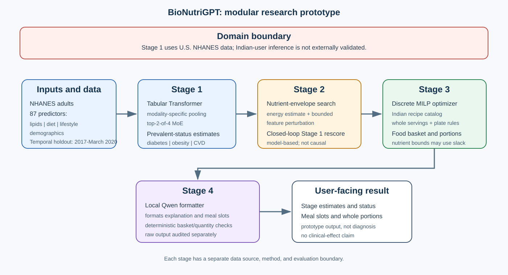
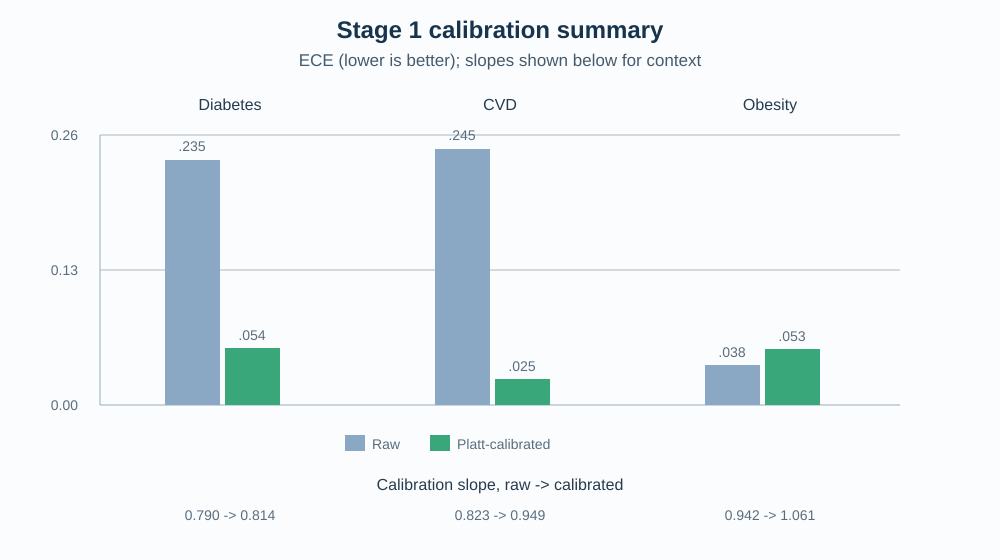
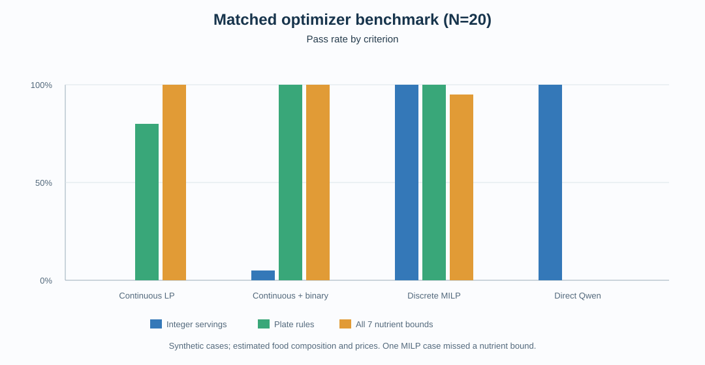

# BioNutriGPT: A modular pipeline for NHANES cardiometabolic risk estimation and discrete Indian meal planning

**Blinded manuscript version.** Author names and affiliations are omitted for peer review; provide them on the journal title page.

## Abstract

**Background:** Prediction models, diet optimizers, and language-model interfaces are often evaluated separately. A system linking risk estimates to meals must preserve nutritional constraints and household portions without implying clinical benefit unsupported by outcome data.

**Objective:** To describe and computationally evaluate BioNutriGPT, a four-stage prototype linking prevalent cardiometabolic risk estimation in U.S. survey data to constrained Indian meal planning and local language-model formatting.

**Methods:** Stage 1 used 87 demographic, dietary, behavioral, and lipid predictors in NHANES 2007-2016 (development N=23,694) and was evaluated on a temporal holdout from NHANES 2017-March 2020 (N=7,046). HbA1c was not a predictor but contributed to the diabetes reference label. Survey-weighted comparisons used 1,000 ordinary participant-bootstrap samples, which do not reproduce the full NHANES stratified-cluster design. Stage 3 compared continuous optimization, binary-dish continuous-serving optimization, a discrete mixed-integer linear program (MILP), and direct local Qwen 2.5 3B generation on 20 matched synthetic cases using the same food catalog, plate rules, nutrient bounds, and scoring objective. Stage 4 used a separate five-case local hardware stress report; its 179.8-second mean does not describe the full pipeline.

**Results:** On the temporal holdout, the Transformer's survey-weighted AUROC was 0.8151 for diabetes, 0.8427 for cardiovascular disease (CVD), and 0.7501 for obesity. Gradient-boosted trees had higher diabetes AUROC (0.8279) and similar obesity AUROC (0.7503); logistic regression had slightly higher CVD AUROC (0.8436). Platt scaling reduced diabetes and CVD expected calibration error (ECE) to 0.0543 and 0.0251, respectively, but residual calibration error remained. In the matched meal-planning comparison (N=20), the MILP produced integer servings and met plate rules in all cases, while meeting all seven nutrient bounds in 19/20. Its mean estimated basket cost was INR 145.35 versus INR 135.48 for continuous LP; mean solve time was 1.66 seconds versus 3.61 ms. Prices were unverified assumptions. Stage 4 local LLM generation had a mean latency of 179.8 seconds in five cases.

**Conclusions:** The evidence supports a computational prototype and a trade-off study for discrete serving constraints. It does not establish superior clinical prediction, causal dietary benefit, Indian-population validity, or clinical safety. The defensible contribution is the auditable separation of prediction, nutrient-envelope generation, discrete meal optimization, and language-model formatting, with component-level evaluation.

**Keywords:** cardiometabolic risk; NHANES; tabular prediction; calibration; mixed-integer optimization; meal planning; Indian foods; large language models

---

## 1. Introduction

Type 2 diabetes, cardiovascular disease (CVD), and obesity are major health concerns in India and globally [1,2]. Digital risk tools may organize demographic, behavioral, dietary, and laboratory information, but a risk estimate alone does not provide an actionable meal plan. Mathematical optimization can construct food combinations subject to selected nutritional targets, while conversational language models can explain or format recommendations. Each component has different limitations: prediction may not transport across populations; an optimizer may return impractical portions; and a language model may alter foods, quantities, or numerical claims [3-10].

BioNutriGPT is a modular computational prototype with four stages: (1) prevalent-condition prediction using a tabular Transformer trained on NHANES; (2) nutrient-envelope generation and model-based rescoring; (3) discrete Indian meal optimization; and (4) local language-model formatting with deterministic output checks. These stages use different data sources and their results should not be described as one clinical validation.

Stage 1 was trained and tested on U.S. NHANES participants, including U.S.-specific race/ethnicity and poverty-income variables. Stage 3 uses an Indian-food catalog. The current version does not establish a validated mapping of NHANES social variables to Indian users or show that replacing them with neutral values preserves predictions. It is therefore not validated for Indian patients. Excluding HbA1c from predictors does not make the input pathway fully non-invasive: blood lipids remain predictors, and HbA1c contributes to the diabetes reference definition.

The paper makes four limited contributions: it documents a four-stage design and its data boundaries; reports a common-metric comparison of Stage 1 models on one temporal holdout; reports a matched optimization comparison using shared foods, constraints, and scoring; and audits a local LLM formatter separately from the optimizer. These are computational evaluations, not a participant-facing intervention or dietitian study.

### 1.1 Related work

**Clinical prediction with tabular data.** Logistic regression and tree ensembles remain important comparators for structured clinical data. Methods such as TabNet, SAINT, and FT-Transformer provide alternative feature-selection or attention-based representations, but comparative work finds no universally best tabular model and emphasizes strong baselines and shared evaluation protocols [11,12,20-23]. A Transformer architecture alone is not evidence of novelty or superiority. TRIPOD+AI and PROBAST+AI provide current reporting and appraisal frameworks [3,13,25]. Calibration also matters when predicted probabilities may inform decisions [5,24].

**Precision nutrition and population transport.** Zeevi et al. and PREDICT investigated individual variation in postprandial responses and personalized dietary approaches [28-30]. Those studies include measurements and/or prospective evaluation not available in this NHANES-based prototype. They motivate further work but do not validate BioNutriGPT risk scores or diet effects. External validation is needed when a prediction model moves across populations or predictor-measurement settings [36]. WHO consultation work identified additional BMI action points for Asian populations, but the current implementation does not use the >=23/25 kg/m^2 cutoffs as an inference rule [27].

**Mathematical diet planning.** Linear and mixed-integer programming have a long history in diet and menu planning. Reviews describe formulations combining nutritional bounds, costs, and acceptability constraints [8,9,33]. Rounding continuous plans can change food quantities and undermine feasibility, motivating integer and quasi-integer formulations [10,34]. Whole-serving optimization is a relevant engineering question, but does not establish that a particular constraint set is clinically complete or culturally acceptable.

**Language models for nutrition.** Recent studies have explored LLM-enabled food recommendation and diet generation, including ChatDiet and evaluations of generated meal plans [6,7,31,32]. Results depend on the task, prompt, and evaluation criteria; they do not support a blanket claim that all LLM diet plans are unsafe. In BioNutriGPT, the language model is restricted to formatting and narrative generation. It does not calculate nutrients or select the optimized basket.

## 2. Methods

### 2.1 Study design and data

Stage 1 is a secondary analysis of NHANES, a repeated cross-sectional survey of the U.S. civilian, non-institutionalized population [14,15]. The reported development cohort comprises 23,694 adults from NHANES 2007-2016, split into training (N=20,140) and internal validation (N=3,554). The temporal holdout comprises 7,046 adults from the 2017-March 2020 pre-pandemic release. This is a temporal holdout within the same survey program, not external validation in India or another country.

Three prevalent outcomes were modeled:

- **Diabetes:** self-reported physician diagnosis, fasting plasma glucose >=126 mg/dL, or HbA1c >=6.5%, according to the project outcome definition [16].
- **Obesity:** measured BMI >=30 kg/m^2.
- **CVD:** self-reported physician diagnosis of congestive heart failure, coronary heart disease, angina, myocardial infarction, or stroke [17].

HbA1c, measured BMI, height, and weight were excluded from Stage 1 predictors. HbA1c nevertheless contributes to the diabetes reference label. Thus, the model estimates prevalent status according to a composite label; it is not an independent diagnostic test, nor is the label restricted to cases identified without blood testing. Routine lipids are predictors, so "non-invasive" is not an accurate description of the full input pathway.

### 2.2 Predictors, U.S.-to-India domain gap, and preprocessing

Stage 1 uses 87 predictors in four groups: five lipid-derived variables; 46 first-day dietary-recall variables; 19 lifestyle and behavioral variables; and 17 demographic/sociodemographic variables. The demographic group includes NHANES race/ethnicity indicators and the U.S. poverty-income ratio (INDFMPIR). Preprocessing parameters were fitted on training data and applied to later splits: training medians/modes for missing values, log transformation for selected skewed nonnegative features, percentile clipping, standardization, and explicit missingness flags.

**No validated Indian inference mapping is implemented.** The code and reports do not document a method that neutralizes or translates U.S.-specific race/ethnicity categories or INDFMPIR for Indian users. Substituting a reference category, setting values to zero, or treating them as missing could change predictions and must not be presented as validated. An Indian model would require a defined target population, harmonized predictors, retraining or justified recalibration, and independent evaluation.

The Stage 1 obesity target uses the NHANES definition BMI >=30 kg/m^2. Although WHO consultation work identified BMI action points for Asian populations, the current system does not apply the >=23/25 kg/m^2 values in Stage 1 or Stage 2. These cutoffs are a future design and validation consideration, not a result of this study [27].

### 2.3 Stage 1 model and evaluation

The model tokenizes each standardized scalar predictor, adds a learned modality embedding, processes tokens with three Transformer encoder layers (dimension 128, four attention heads), pools features by modality, and combines the pooled representation through a top-2-of-4 mixture-of-experts module. Separate output heads estimate diabetes, obesity, and CVD probabilities.

Baselines were evaluated on the same temporal holdout: a deep MLP, tabular ResNet, gradient-boosted trees, random forest, and logistic regression. Table 1 reports survey-weighted AUROC and Brier score from the reconciled model-comparison report. Its 95% intervals use 1,000 bootstrap draws resampling participants independently. This does not fully reproduce NHANES strata, primary sampling units, or replicate-weight variance; the intervals should be read as approximate rather than design-based. Performance point estimates use the reported NHANES examination weight.

Calibration was assessed with ECE, calibration slope/intercept, and Brier score. Platt scaling was fitted on the development validation split and evaluated on the temporal holdout. Decision-curve and subgroup outputs exist in the project report, but do not establish clinical utility or fairness without prespecified decision thresholds, design-aware uncertainty, and external replication.

**Component ablations were not run.** The results do not isolate the contribution of modality-query pooling or top-2 MoE. These components are implementation details, not proven sources of performance gain.

### 2.4 Stage 2 nutrient envelope and closed-loop rescore

Stage 2 receives a feature vector, patient metadata, and Stage 1 risk scores. It estimates an energy target using the Mifflin-St Jeor equation and an activity multiplier, constructs nutrient bounds, searches candidate nutrient values, then sends the final candidate back through Stage 1 for closed-loop rescoring. Safety and consistency checks can reject a candidate before it is passed to Stage 3 [26].

This is a model-based counterfactual search, not a causal dietary-effect model. A lower Stage 1 score after changing synthetic nutrient features does not show that eating the corresponding diet will reduce disease risk. One saved example passed the closed-loop gate; the model-score changes were -0.0767 for diabetes, -0.0415 for obesity, and -0.0151 for CVD. These are outputs for one example, not observed outcomes. No cohort-level Gate 4 pass rate or clinical effect estimate is reported.

### 2.5 Stage 3 discrete meal optimizer

The matched benchmark compares four methods on 20 synthetic cases (five each for diabetes-predominant, obesity, CVD, and multimorbidity profiles): continuous linear programming (LP); continuous servings with binary food selection; discrete mixed-integer linear programming (MILP); and direct local Qwen 2.5 3B generation. Each method used the same 44-item food catalog, seven scored nutrient bounds, plate constraints, estimated cost inputs, and scoring objective. The LLM was given case targets and food options; its output was scored against the same rules but did not solve the mathematical objective.

The project catalog is derived from cooked Indian recipes and mapped to IFCT 2017 fields. Some food-composition values are estimated, and prices are manually entered assumptions not verified as current market prices. This is a software comparison using a fixed catalog, not validated nutritional analysis or a current affordability study.

The matched benchmark applied these serving-count constraints: cereals 3-5 servings, pulses/dal 2-3, vegetables 2-4, and dairy 1-2; 4-8 active dishes overall; up to three servings of one food item. The MILP objective penalized nutrient deviation, calorie deviation, dish count, and estimated cost. Nutrient limits used scored deviations, so an integer solution did not guarantee that every bound would be met. A separate 50-case optimizer stress report used a different catalog and comparison setup; it is not used as the matched head-to-head result.

### 2.6 Stage 4 local language-model formatter

Stage 4 uses a local Qwen 2.5 3B Instruct model with 4-bit NF4 quantization. Its intended role is to create a narrative and meal-slot schedule from an already optimized basket. Deterministic code checks output structure and compares generated food identifiers and quantities with the fixed basket; invalid output can trigger deterministic repair or fallback. These checks constrain the evaluated format but do not prove that all prose is medically correct or that a meal plan is clinically safe.

Stage 4 is assessed using the available measured local-GPU stress report (N=5 synthetic dossiers); these are not real patients and are not the Stage 3 matched optimizer cases. The reported 179.8-second latency is a five-case measurement. A separate artifact labeled as a 100-case reliability report is excluded from empirical claims because its generating script hard-codes raw-generation failure counts, repetition outcomes, and selected stochastic rates instead of calculating them from retained per-case LLM outputs. The script does exercise deterministic scheduling, integrity checks, and selected edge cases, but these checks are not equivalent to a 100-case real-LLM evaluation. Therefore, this manuscript makes no 100-case raw-versus-guarded LLM reliability claim.

### 2.7 Human evaluation

No dietitian ratings, patient acceptability study, or clinical trial was conducted. A future dietitian evaluation could assess nutrient-data validity, household feasibility, regional palatability, meal timing, and safety. Until a protocol is approved, participants recruited, and ratings collected, the paper does not claim IDA collaboration, preregistration, blinding, power, or professional endorsement.

## 3. Results

### 3.1 Stage 1 model comparison

**Table 1. Survey-weighted performance on the NHANES temporal holdout (N=7,046).** All rows use the same test cohort and evaluation report. AUROC intervals are approximate participant-bootstrap intervals; Brier scores are point estimates.

| Outcome | Model | Weighted AUROC (95% interval) | Weighted Brier |
|---|---|---:|---:|
| Diabetes | BioNutriGPT Transformer, raw | 0.8151 (0.7953-0.8333) | 0.1660 |
| Diabetes | BioNutriGPT Transformer, Platt-calibrated | 0.8151 (0.7953-0.8333) | 0.1042 |
| Diabetes | Gradient-boosted trees | **0.8279 (0.8104-0.8441)** | **0.1034** |
| Diabetes | Logistic regression | 0.8080 (0.7892-0.8261) | 0.1539 |
| Diabetes | Random forest | 0.8024 (0.7816-0.8211) | 0.1074 |
| Diabetes | Deep MLP | 0.8080 (0.787-0.826) | 0.1611 |
| Diabetes | Tabular ResNet | 0.8116 (0.791-0.831) | 0.1506 |
| CVD | BioNutriGPT Transformer, raw | 0.8427 (0.8203-0.8626) | 0.1509 |
| CVD | BioNutriGPT Transformer, Platt-calibrated | 0.8427 (0.8203-0.8626) | 0.0739 |
| CVD | Logistic regression | **0.8436 (0.8237-0.8620)** | 0.1471 |
| CVD | Gradient-boosted trees | 0.8407 (0.8211-0.8594) | **0.0748** |
| CVD | Random forest | 0.8202 (0.7980-0.8402) | 0.0760 |
| CVD | Deep MLP | 0.8361 (0.814-0.854) | 0.1654 |
| CVD | Tabular ResNet | 0.8384 (0.816-0.856) | 0.1642 |
| Obesity | BioNutriGPT Transformer, raw | 0.7501 (0.7336-0.7662) | 0.2017 |
| Obesity | BioNutriGPT Transformer, Platt-calibrated | 0.7501 (0.7336-0.7662) | 0.2020 |
| Obesity | Gradient-boosted trees | **0.7503 (0.7340-0.7664)** | 0.2025 |
| Obesity | Logistic regression | 0.7471 (0.7314-0.7632) | 0.2021 |
| Obesity | Random forest | 0.7328 (0.7152-0.7501) | 0.2117 |
| Obesity | Deep MLP | 0.7460 (0.730-0.762) | 0.2071 |
| Obesity | Tabular ResNet | 0.7485 (0.732-0.765) | 0.2045 |

GBT had the highest diabetes AUROC and a slightly lower weighted Brier score than the raw Transformer. Logistic regression had a marginally higher CVD AUROC; calibrated Transformer and GBT CVD Brier scores were similar. Obesity discrimination was nearly tied between Transformer and GBT. These results do not show that the Transformer is the best model overall.

**Calibration.** Platt scaling reduced diabetes ECE from 0.2353 to 0.0543 and CVD ECE from 0.2452 to 0.0251. The calibrated slopes were approximately 0.81 for diabetes, 0.95 for CVD, and 1.06 for obesity; the diabetes slope indicates residual calibration error. Obesity ECE increased from 0.0383 to 0.0534 and weighted Brier changed from 0.2017 to 0.2020. Calibration improved selected metrics, not all outcomes.

The report supports summary calibration metrics. Calibration curves were not reconstructed because patient-level prediction bins were not available among the saved report artifacts.

**Ablation status.** The evaluation compared whole model families but did not remove or replace individual components inside BioNutriGPT.

| Component | Ablation performed? | Conclusion supported |
|---|---|---|
| Modality-query pooling | No | Independent effect unknown. |
| Top-2 MoE | No | Independent effect unknown. |
| Full Transformer+MoE | Yes, as one complete model | Competitive with neural baselines; not consistently better than GBT or logistic regression. |

### 3.2 Stage 2 closed-loop gate

In the single saved Stage 2 example, the closed-loop rescore gate passed. Stage 1 probabilities changed by -0.0767 for diabetes, -0.0415 for obesity, and -0.0151 for CVD between the baseline feature vector and final nutrient candidate. Since the candidate was formed by changing model inputs and was not consumed or clinically measured, these are model-score changes only, not estimated treatment effects. No cohort-level Gate 4 performance is available.

### 3.3 Matched Stage 3 optimization comparison

**Table 2. Matched comparison on 20 synthetic cases.** Methods used the same catalog, plate rules, nutrient bounds, and scoring objective. "All nutrient bounds met" means all seven scored bounds were met. Costs are unverified benchmark estimates.

| Method | Integer servings | Plate rules met | All 7 nutrient bounds met | Mean fractional food count | Mean estimated cost | Mean runtime |
|---|---:|---:|---:|---:|---:|---:|
| Continuous LP | 0/20 (0%) | 16/20 (80%) | 20/20 (100%) | 3.95 | INR 135.48 | 3.61 ms |
| Continuous servings + binary dish selection | 1/20 (5%) | 20/20 (100%) | 20/20 (100%) | 1.70 | INR 140.79 | 314 ms |
| Discrete MILP | **20/20 (100%)** | **20/20 (100%)** | 19/20 (95%) | **0.00** | INR 145.35 | 1.66 s |
| Direct Qwen 2.5 3B output | 20/20 (100%) | 0/20 (0%) | 0/20 (0%) | 0.00 | INR 55.25 | 7.10 s |

Compared with continuous LP, the MILP's estimated cost was about 7.3% higher and mean solver time was much longer (1.66 s versus 3.61 ms). Compared with continuous servings plus binary dish selection, it cost about 3.2% more and took about 5.3 times as long, while increasing integer-serving plans from 1/20 to 20/20. It missed a nutrient bound in one case, so these data do not support universal nutrient feasibility or safety. Direct Qwen output had a mean 6.6 nutrient violations per plan and did not satisfy plate rules in this test; its lower estimated cost reflects outputs that failed the shared requirements.

A separate 50-case optimizer stress report showed a mean MILP solve time of 346.3 ms, but it used a different food catalog and comparison setup. That result is not interchangeable with the 20-case matched benchmark above.

### 3.4 Stage 4 local LLM and hardware

**Table 3. Earlier Stage 4 local hardware stress report (N=5).** This is a five-case result, not a 50-case reliability estimate.

| Measure | Reported result |
|---|---:|
| Model/hardware | Qwen 2.5 3B, 4-bit NF4; RTX 3050 Laptop GPU |
| Allocated / reserved VRAM | 1,971.4 / 2,284 MiB |
| Token throughput | 16.14 tokens/s |
| Mean latency | 179.8 s per dossier |
| Median / p95 latency | 173.8 s / 305.9 s |
| Guarded invariant checks | 5/5 passed |

The local Stage 4 call is separate from the Stage 3 MILP solve; 179.8 s is not "sub-second" and is not the latency of the full pipeline. The 5/5 guarded checks are descriptive of this small stress run and do not establish a general reliability rate. The guard checks the final schedule against the optimizer basket, but a guarded pass does not imply that the raw LLM response was valid. In earlier small reliability runs, raw responses often changed quantities or failed JSON parsing, and deterministic repair was activated. No general zero-hallucination guarantee is claimed.

## 4. Discussion

### 4.1 Interpretation

The main result is a system decomposition with separate evidence boundaries. Stage 1 estimates cross-sectional prevalent status from NHANES variables. Stage 2 searches nutrient feature values and re-scores them through Stage 1. Stage 3 solves a constrained food-selection problem. Stage 4 formats a basket and is checked by deterministic code. This design helps trace outputs to a model, constraint set, or code check.

The model comparison does not establish Transformer superiority. GBT performed best for diabetes AUROC, logistic regression had a slightly higher CVD AUROC, and obesity scores were nearly tied. Modality pooling and MoE ablations are absent, so their independent value is unknown. Further work should compare FT-Transformer and TabNet with identical tuning budgets while retaining simple regression and GBT baselines [11,12,20-23].

The matched meal-planning experiment supports a narrower conclusion: whole-serving constraints can make outputs more household-like, but may increase runtime and cost. The MILP achieved integer servings and plate-rule compliance in all 20 cases, cost more than continuous methods, and missed a nutrient bound in one case. Whether the trade-off is acceptable must be tested with users and dietitians; current costs and nutrient values are not sufficiently verified.

Stage 4 must be interpreted by separating raw generation from guarded output. Deterministic repair can make a schedule structurally valid even when the original LLM output was invalid. A guard pass rate demonstrates behavior only for the tested cases, prompt, and software version; it does not prove that all prose is medically correct.

### 4.2 Clinical and Indian-population limitations

The largest limitation is domain mismatch. Stage 1 was developed and temporally evaluated in U.S. NHANES. It includes U.S.-specific social and race/ethnicity predictors, and there is no validated Indian input mapping, external Indian evaluation, or recalibration. Pairing this model with Indian meals does not make its risk estimates valid for Indian users.

The outcomes are prevalent conditions in cross-sectional data, not future disease onset. Stage 2 modifies model features and checks resulting scores; it does not estimate causal food effects. Some Stage 3 food-composition fields are estimated, and its cases are synthetic. Stage 4 is also tested on synthetic dossiers. No dietitian or patient rated the plans, and no intervention was delivered.

The calibration bootstrap resampled people rather than NHANES sampling units. Further work should use survey-design-aware variance estimation and report calibration curves, intercepts, slopes, Brier scores, and decision curves with uncertainty. Thresholds need justification for an intended decision. Subgroup results remain exploratory until adequately powered and externally replicated.

### 4.3 Next research steps

Before clinical use or a high-impact clinical claim, the project needs: (1) an Indian cohort with harmonized predictors and appropriate outcome definitions; (2) prespecified handling of U.S.-specific predictors followed by independent validation; (3) component ablations and broader tabular baselines; (4) verified recipe data, audited prices, and larger matched solver benchmarks; (5) external testing of the Stage 4 guard with raw-error and fallback rates; and (6) dietitian evaluation followed by prospective study. WHO Asian BMI action points may be considered in future protocol design but must not be reported as part of the evaluated system [27].

A dietitian evaluation remains future work. A protocol would need ethics review, recruitment, and actual ratings before Methods and Results can report blinding, power, or professional endorsement.

## 5. Conclusion

BioNutriGPT is a computational prototype linking NHANES-based prevalent-risk estimates with model-based nutrient envelopes, discrete Indian meal optimization, and guarded local language-model formatting. The Transformer is competitive but not consistently better than GBT or logistic regression. In a small matched benchmark, a discrete MILP produced whole-serving plans at higher estimated cost and runtime, while one plan missed a nutrient bound. The current evidence does not establish Indian-population validity, causal risk reduction, clinical safety, or acceptability. These are the next validation requirements.

## Declarations

**Ethics approval and consent to participate:** This study uses secondary analysis of public, de-identified NHANES data and includes no newly recruited participants. An institutional ethics/IRB determination for this secondary analysis is not documented in the project materials and must be reported before journal submission. Cite relevant NHANES ethics and consent documentation in the submitted version [14,15].

**Data availability:** NHANES data are publicly available from the U.S. National Center for Health Statistics [14,15]. Synthetic cases and derived reports are project artifacts; archive the manuscript-matched analysis version with an identifier.

**Code availability:** The public project repository is [github.com/Mani8662/BioNutriGPT](https://github.com/Mani8662/BioNutriGPT). Add or tag the exact scripts and commit that generated these analyses before submission; the public listing has not been verified to contain all analysis artifacts.

**Competing interests:** A declaration was not present in the project materials. Authors should provide the applicable statement.

**Funding:** Funding information was not present in the project materials. Authors should provide the applicable statement.

**Author contributions (CRediT):** Author names and role assignments were not present in the project materials. Add contributions after the author list is finalized.

## References

1. Misra A, Ramchandran A, Jayawardena R, Shrivastava U, Snehalatha C. Diabetes in South Asians. *The Lancet Diabetes & Endocrinology*. 2014;2(11):840-843.
2. Anjana RM, Unnikrishnan R, Deepa M, et al. Metabolic non-communicable disease health report of India: the ICMR-INDIAB national cross-sectional study. *The Lancet Diabetes & Endocrinology*. 2023;11(7):474-489.
3. Collins GS, Moons KGM, Dhiman P, et al. TRIPOD+AI statement: updated guidance for reporting clinical prediction models that use regression or machine learning methods. *BMJ*. 2024;385:e078378.
4. Longvah T, Ananthan R, Bhaskarachary K, Venkaiah K. *Indian Food Composition Tables 2017*. National Institute of Nutrition, Indian Council of Medical Research; 2017.
5. Vickers AJ, Elkin EB. Decision curve analysis: a novel method for evaluating prediction models. *Medical Decision Making*. 2006;26(6):565-574.
6. Yang Z, Khatibi E, Nagesh N, et al. ChatDiet: empowering personalized nutrition-oriented food recommender chatbots through an LLM-augmented framework. *Smart Health*. 2024;32:100465.
7. Singhal K, Azizi S, Tu T, et al. Large language models encode clinical knowledge. *Nature*. 2023;620:172-180.
8. Donkor L, Essien E, Affrifah NS. A systematic review of linear programming techniques as applied to diet optimisation and opportunities for improvement. *Journal of Optimization*. 2023;2023:1271115.
9. Ferguson EL, Darmon N, Briend A, Premachandra JM. Food-based dietary guidelines can be developed and tested using linear programming analysis. *The Journal of Nutrition*. 2004;134(4):951-957.
10. Gerdessen JC, de Vries JHM. Diet models with linear programming: to round or not to round? *The American Journal of Clinical Nutrition*. 2015;101(4):891-892.
11. Gorishniy Y, Rubachev I, Khrulkov V, Babenko A. Revisiting deep learning models for tabular data. *Advances in Neural Information Processing Systems*. 2021;34:18932-18943.
12. Shwartz-Ziv R, Armon A. Tabular data: deep learning is not all you need. *Information Fusion*. 2022;81:84-90.
13. Moons KGM, Altman DG, Reitsma JB, et al. Transparent Reporting of a multivariable prediction model for Individual Prognosis Or Diagnosis (TRIPOD): explanation and elaboration. *Annals of Internal Medicine*. 2015;162(1):W1-W73.
14. National Center for Health Statistics. *NHANES Analytic Guidance and Brief Overview for the 2017-March 2020 Pre-Pandemic Data Files*. Centers for Disease Control and Prevention; 2021.
15. National Center for Health Statistics. *NHANES 2017-March 2020 Demographic Variables and Sample Weights: Documentation and Codebook*. Centers for Disease Control and Prevention; 2021.
16. American Diabetes Association Professional Practice Committee. Standards of Care in Diabetes-2024. *Diabetes Care*. 2024;47(Suppl 1):S1-S343.
17. Arnett DK, Blumenthal RS, Albert MA, et al. 2019 ACC/AHA guideline on the primary prevention of cardiovascular disease. *Circulation*. 2019;140(11):e596-e646.
18. Indian Council of Medical Research-National Institute of Nutrition. *Nutrient Requirements for Indians: Recommended Dietary Allowances and Estimated Average Requirements*. ICMR-NIN; 2020.
19. Huangfu Q, Hall JAJ. Parallelizing the dual revised simplex method. *Mathematical Programming Computation*. 2018;10(1):119-142.
20. Arik SO, Pfister T. TabNet: attentive interpretable tabular learning. *Proceedings of the AAAI Conference on Artificial Intelligence*. 2021;35(8):6679-6687.
21. Somepalli G, Goldblum M, Schwarzschild A, Bruss CB, Goldstein T. SAINT: improved neural networks for tabular data via row attention and contrastive pre-training. *NeurIPS 2021 Workshop on Self-Supervised Learning for Reasoning and Perception*. 2021.
22. Chen T, Guestrin C. XGBoost: a scalable tree boosting system. In: *Proceedings of the 22nd ACM SIGKDD International Conference on Knowledge Discovery and Data Mining*. 2016:785-794.
23. Ke G, Meng Q, Finley T, et al. LightGBM: a highly efficient gradient boosting decision tree. In: *Advances in Neural Information Processing Systems*. 2017;30.
24. Van Calster B, McLernon DJ, van Smeden M, Wynants L, Steyerberg EW. Calibration: the Achilles heel of predictive analytics. *BMC Medicine*. 2019;17:230.
25. Moons KGM, Damen JAA, Kaul T, et al. PROBAST+AI: an updated quality, risk of bias, and applicability assessment tool for prediction models using regression or artificial intelligence methods. *BMJ*. 2025;388:e082505.
26. Mifflin MD, St Jeor ST, Hill LA, Scott BJ, Daugherty SA, Koh YO. A new predictive equation for resting energy expenditure in healthy individuals. *The American Journal of Clinical Nutrition*. 1990;51(2):241-247.
27. WHO Expert Consultation. Appropriate body-mass index for Asian populations and its implications for policy and intervention strategies. *The Lancet*. 2004;363(9403):157-163.
28. Zeevi D, Korem T, Zmora N, et al. Personalized nutrition by prediction of glycemic responses. *Cell*. 2015;163(5):1079-1094.
29. Berry SE, Valdes AM, Drew DA, et al. Human postprandial responses to food and potential for precision nutrition. *Nature Medicine*. 2020;26(6):964-973.
30. Popp CJ, Hu L, Kharmats AY, et al. Effect of a personalized diet to reduce postprandial glycemic response vs a low-fat diet on weight loss in adults with abnormal glucose metabolism and obesity: a randomized clinical trial. *JAMA Network Open*. 2022;5(9):e2233760.
31. Niszczota P, Rybicka I. The credibility of dietary advice formulated by ChatGPT: robo-diets for people with food allergies. *Nutrition*. 2023;112:112061.
32. Hieronimus B, Hammann S, Podszun MC. Can the AI tools ChatGPT and Bard generate energy, macro- and micro-nutrient sufficient meal plans for different dietary patterns? *Nutrition Research*. 2024;128:105-114.
33. van Dooren C. A review of the use of linear programming to optimize diets, nutritiously, economically and environmentally. *Frontiers in Nutrition*. 2018;5:48.
34. Armstrong RD, Sinha P. Application of quasi-integer programming to the solution of menu planning problems with variable portion size. *Management Science*. 1974;21(4):474-482.
35. Obermeyer Z, Powers B, Vogeli C, Mullainathan S. Dissecting racial bias in an algorithm used to manage the health of populations. *Science*. 2019;366(6464):447-453.
36. Debray TPA, Vergouwe Y, Koffijberg H, Nieboer D, Steyerberg EW, Moons KGM. A new framework to enhance the interpretation of external validation studies of clinical prediction models. *Journal of Clinical Epidemiology*. 2015;68(3):279-289.
