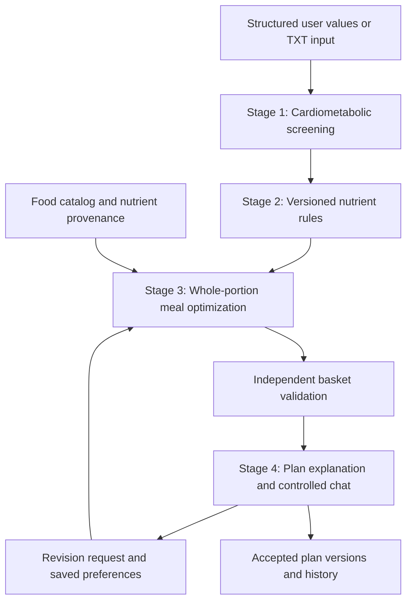

# BioNutriGPT: An Auditable Pipeline for Cardiometabolic Screening and Constraint-Preserving Conversational Meal Planning

## Abstract

**Background:** Conversational meal planning requires persistent preferences and reliable numerical verification as users request changes.

**Objective:** To develop and evaluate an auditable pipeline linking cardiometabolic screening, nutritional rules, discrete meal optimization and controlled conversational revision.

**Methods:** Stage 1 uses an 87-feature Transformer evaluated on a 7,046-participant NHANES temporal holdout. Downstream planning uses a 49-entry food catalog and 30 active nutrient fields. A separate LASI-derived evaluation includes 100 selected Indian profiles across three dietary modes. The corrected conversational study uses 36 distinct participants and 78 turns per guarded variant, with a matched 12-participant, 24-turn Qwen 2.5 3B comparison. Requests are frozen; incomplete foods are excluded consistently; proposals undergo numerical validation. Uncertainty is estimated by scenario-level resampling.

**Results:** Saved Stage 1 AUROCs were 0.7999 for diabetes, 0.7518 for obesity and 0.8260 for CVD. LASI optimizer acceptance was 91/100, 96/100 and 98/100 across dietary modes. The full guarded conversational system passed 76/78 turns, including 29 validated revisions and 11 justified refusals; two timeout-related failures remained. In the matched comparison, protocol passes were 24/24 versus 2/24, and valid proposals on feasible requests were 9/9 versus 0/9. Among 25 successful pairs with identical input state, mean serving changes were 7.72 with the change penalty versus 16.56 without it, a descriptive reduction of 53.38%.

**Conclusions:** The tested workflow supports auditable, less disruptive meal revision under declared computational rules. These selected-case results do not establish clinical benefit, patient acceptability, national performance or Stage 1 validity in India.

**Keywords:** nutrition decision support; conversational systems; mixed-integer optimization; provenance; tabular Transformer; Indian meals; reproducibility.

## 1. Introduction

Personalized meal planning combines nutritional accounting, food preferences, portion selection, and repeated requests for change. A user may ask to remove a dish, retain a preferred food, reduce the number of dishes, or inspect the nutrients in an updated plan. These operations require consistent numerical accounting and persistent state. A fluent answer alone does not establish that the updated basket satisfies its declared requirements.

BioNutriGPT addresses this engineering problem through four connected stages. A screening model describes prevalent cardiometabolic outcomes in the NHANES study setting. A nutrient-rule engine supplies an explicit planning envelope. A discrete optimizer selects food portions. A conversational service explains the resulting plan and routes revisions back through optimization and validation. Observed patient inputs remain separate from proposed and accepted meals.

The principal research question is: **Can a stateful, tool-backed nutrition assistant support repeated meal-plan revisions while preserving declared constraints and previously recorded restrictions?** Secondary questions concern the computational trade-offs of whole portions and the usefulness of the screening component relative to simpler models. Clinical benefit is outside the present evaluation.

### 1.1 Related work and scope of contribution

Conversational nutrition recommendation already has substantial precedent. ChatDiet combines personal and population information through an orchestration framework to produce personalized food recommendations [1]. Therefore, adding a chatbot to nutrition recommendations is not, by itself, a defensible novelty claim.

Integer and goal-programming approaches to meal planning also exist. A recent preprint explicitly studies serving granularity and compares mixed-integer goal programming with continuous and rounded alternatives [2]. Whole portions, HiGHS optimization, and nutrient-deviation objectives must therefore be treated as established methods rather than new algorithms.

Tabular Transformers likewise belong to an established methodological family. Comparative work on tabular deep learning demonstrates the importance of strong baselines and consistent evaluation protocols [3]. The use of a Transformer or mixture-of-experts component does not establish predictive advantage without direct experimental support.

The contribution investigated here is the **combined, testable revision workflow**: catalog-grounded answers; explicit separation of observed, proposed, and accepted state; persistent food restrictions; re-optimization after requests; independent acceptance validation; and version-aware auditability. The present related-work comparison establishes overlap, not an exhaustive literature search or a claim that this combination is the first of its kind.

## 2. Methods

### 2.1 Study design and evidence boundaries

This is a retrospective prediction and computational systems study. We distinguish four evidence layers:

1. **Prediction evaluation:** saved Stage 1 results on the NHANES temporal holdout.
2. **Historical system experiments:** optimizer and conversational comparisons performed on earlier food-catalog versions.
3. **Current implementation verification:** a descriptive snapshot of the 49-entry catalog and regression checks following chatbot repairs.
4. **LASI real-profile pilot:** adapted rule-based planning on 100 Indian profiles and a separately audited conversational subset.

These layers are not pooled. In particular, software regression checks are not counted as patient cases, and results from different food catalogs are not combined into a current-system success rate. TRIPOD+AI informs the prediction-reporting requirements; completed checklist adherence is not asserted [4].

### 2.2 Cohorts, outcomes, and predictors

The development file contains 23,694 NHANES participants from 2007–2016. The holdout file contains 7,046 participants from 2017–March 2020. A direct identifier comparison found no overlapping `SEQN` values. NHANES provides U.S. population survey data; a later survey period is a temporal holdout, not an Indian validation cohort [5].

| Dataset | Participants | Diabetes-positive | Obesity-positive | CVD-positive |
|---|---:|---:|---:|---:|
| Development, 2007–2016 | 23,694 | 3,022 | 8,932 | 2,205 |
| Temporal holdout, 2017–March 2020 | 7,046 | 1,409 | 3,075 | 845 |

The current outcome-generation code defines diabetes using any available positive HbA1c, fasting-glucose, or physician-diagnosis criterion; obesity uses measured BMI at least 30 kg/m²; CVD uses positive self-reported heart failure, coronary disease, angina, myocardial infarction, or stroke responses. These are operational dataset labels, not diagnoses made by the application. The code can assign a negative outcome when at least one component is observed and no observed component is positive; incomplete ascertainment is consequently a possible source of label error.

The model has 87 predictors: five lipid measurements or derived lipid measures; 46 dietary features comprising 39 nutrient fields and seven derived ratios; 19 lifestyle features; and 17 demographic or missingness features. HbA1c and fasting glucose are not predictors. Because lipid inputs require laboratory measurements, the system is described as **non-glycemic laboratory-assisted screening**, not non-invasive screening. The exact feature names are supplied in `evidence_snapshot.json`.

Preprocessing artifacts and model feature ordering are reused at inference. The training script specifies a 20,140-participant training subset and 3,554-participant validation subset, with a fixed seed and diabetes-stratified splitting. Full inclusion/exclusion flow, preprocessing-fit boundaries, and label ascertainment by survey component must be documented from executable source before submission.

### 2.3 Architecture and screening model

Stage 1 tokenizes the 87 scalar predictors into 128-dimensional representations with modality embeddings. A three-layer Transformer encoder uses four attention heads per layer. Learned modality-query pooling produces biochemical, dietary, lifestyle, and demographic vectors. A four-expert sparse layer uses top-two routing, followed by outcome-specific prediction heads.

This architecture is implemented, but the current evidence does not isolate the benefit of modality pooling or expert routing. These components are not presented as independently validated contributions.

The saved evaluation includes logistic regression, random forest, and histogram gradient boosting. Its classical comparators use the full development file, whereas the neural model's training procedure reserves a validation subset. This difference must be acknowledged and corrected before using those results for a claim of architectural superiority.

### 2.4 Stage 2: Versioned nutritional planning rules

Stage 2 combines patient metadata, energy calculations, nutrient bounds, and model-based hypothetical dietary search. A counterfactual candidate changes proposed dietary inputs for computational analysis; it is not a measured intervention or a causal estimate of disease reduction. The chatbot does not overwrite observed intake or reinterpret a proposed food swap as an observed clinical improvement.

The current rule version is `adult-food-rule-review-v4-exposure-separated`. Of 39 nutrient/exposure fields, 30 are active planning fields, seven are report-only, and two—caffeine and alcohol—are tracked separately as exposures. Total sugar is not treated as free sugar; total folate, synthetic folic acid, food folate, and dietary folate equivalents are distinguished. Numerical search caps are not described as tolerable upper intake levels.

Several rules remain project assumptions, including parts of the protein, carbohydrate, sodium, potassium, and cholesterol policy. References in the rule metadata identify context; they do not imply that a clinical authority endorsed every project threshold. The implementation uses a mixture of reference sources and project choices and is not represented as complete ICMR-NIN guideline compliance [6].

The intended computational scope is adults. Pregnancy, lactation, pediatric prescribing, renal disease management, and medication adjustment are outside the chatbot's supported scope.

### 2.5 Food composition and missingness

The current catalog version is `sourced-cooked-v5-veg-nonveg`. It contains 49 records: 20 INDB recipe variants and 29 USDA single-food proxies. INDB is a published recipe-composition resource, while USDA records provide additional food-composition data [7,8]. Selected ingredient-level gap filling also uses documented food matches from CoFID [9]. These sources do not make every proxy identical to an Indian household preparation.

| Catalog characteristic | Current snapshot |
|---|---:|
| Total records | 49 |
| INDB recipe variants | 20 |
| USDA single-food proxies | 29 |
| Vegetarian records | 43 |
| Non-vegetarian records | 6 |
| Records without declared active-field gaps, before other filters | 43 |
| Records with at least one known allergen tag | 20 |
| Records retaining possible unknown allergens | 49 |

All 49 records must not be described as laboratory-validated cooked Indian dishes. Standardized gram portions are modeling units, and agreement with a household bowl, recipe yield, or serving convention has not been established for every entry. Calculated ingredient-level nutrients and matched proxies are distinguished from directly reported recipe values through provenance metadata.

The current catalog still has declared active-field gaps in synthetic folic acid, folate equivalents, alpha-tocopherol, retinol, or vitamin B12 for a subset of recipes. Foods missing a required active nutrient are excluded from a solve rather than assigned zero. Passing computational checks establishes consistency with the selected catalog values, not the accuracy of those values under actual preparation.

### 2.6 Stage 3: Discrete planning and acceptance

For food i, let q_i be its integer number of standardized portions, z_i indicate selection, and a_ki denote nutrient k per portion. Selected foods satisfy q_i in {0,1,2,3} with linking constraints z_i <= q_i <= 3z_i. A plan contains four to eight active foods unless a supported tighter dish limit is requested. Dietary-mode-specific food-category and serving constraints further restrict the basket.

For active nutrient k, the accepted basket must satisfy:

`L_k <= sum_i(a_ki * q_i) <= U_k`.

The implementation retains deviation variables from a goal-programming formulation, but fixes active nutrient-bound deviations to zero during the current production solve. Report-only fields and separately tracked exposures are not converted into active adequacy requirements.

Within the feasible set, the objective penalizes food-selection cost and absolute energy-target deviation. For revisions, an additional term penalizes `sum_i |q_i - q_i_previous|`, encouraging smaller changes. The selection-cost parameter is an engineering preference and is not assumed to be a verified retail price. Preferred foods influence optimization without authorizing violations of protected rules.

Every proposed or accepted basket passes a separate validator that recalculates nutrients and checks relevant structural requirements. A rejected candidate is not substituted as a successful plan. Failure responses retain the previously accepted plan and distinguish data insufficiency, unavailable locked foods, solver limits, and other reported conflicts.

### 2.7 Stage 4: Grounded conversation and persistent state

The controlled chat service uses explicit backend tools for plan inspection, nutrient totals, revision proposals, and conflict explanations. Intent detection is primarily deterministic. It is not described as a fully autonomous LLM agent. The separate report-compilation path can use a local Qwen model under schema and quantity checks; its behavior is evaluated separately from the controlled chatbot.

Patient records, proposals, and accepted versions are separate objects. Revision requests retain existing exclusions, preferred foods, daily food-quantity locks, ingredient exclusions, and dish limits. Persistent-session acceptance requires an exact match to a server-stored pending proposal for the current version, followed by independent validation. Accepting a revision creates a new version; rollback restores a prior basket and its plan preferences without deleting later patient-level allergy declarations.

Allergy questions do not, by themselves, update the patient record. Explicit declarations create or update persistent allergy state and invalidate older pending proposals. Foods with documented matching allergens are excluded from subsequent revisions. Because allergen metadata are incomplete, warnings remain visible after numerical acceptance and rollback. The system does not certify a plan as allergen-free.

Optional unconstrained LLM rewriting of chatbot answers is disabled. A previous number-preservation check could not prevent semantic changes, including removal of caveats. Verified deterministic answers therefore remain authoritative. This restriction does not remove the separately implemented report compiler.

The frontend supports proposal review and an optional automatic application setting. When enabled, that setting applies only server-verified proposals; studies must record whether it was enabled. Daily food-quantity locks do not establish that an entire meal slot remains unchanged after rescheduling.

### 2.8 Evaluation and analysis

For Stage 1, we report the saved unweighted temporal-holdout AUROC, average precision, and Brier score. Survey-weighted analyses exist but require a fuller audit of weight choice, missing-weight handling, and complex-survey uncertainty. Participant-level bootstrap intervals do not, by themselves, account for NHANES stratification and clustering.

LLM-related reporting is mapped separately using TRIPOD-LLM; the working reporting map does not assert checklist completion [10].

The existing recalibration analysis is not used to substantiate current calibrated performance. Its calibration subset is recreated without the training script's diabetes stratification, and its logistic recalibrator uses predicted probabilities as input. Independence from model fitting and compatibility with deployed inference require reconciliation before describing a calibrated model as validated.

Two historical comparisons are retained as version-specific preliminary evidence: a 20-case, 29-entry optimizer comparison and an eight-scenario, 16-turn, 31-entry conversational comparison. Their limitations and denominators are reported explicitly. A file labeled as a 100-case Stage 4 reliability evaluation is excluded from empirical evidence because the inspected script assigns failure counts and latency summaries rather than measuring 100 independent model executions.

The earlier application verification comprises 11 chatbot checks and 13 production checks; a later rerun found one failing allergy-declaration expectation. Separately, eight benchmark-correction checks passed before the final v4 execution, including checkpoint persistence and simulated end-to-end report export. The targeted tests use synthetic food fixtures and temporary session stores. The existing suite includes a real-catalog sample and food-swap check. These checks evaluate defined software behavior, not population-level effectiveness or clinician acceptability.

### 2.9 LASI real-profile computational evaluation

The new evaluation uses LASI Wave 1 anthropometry, demographics and reported diagnoses [11]. The extraction summary reports 66,859 merged biomarker/individual records and 65,368 eligible records after age, anthropometric, BMI and diagnosis-completeness filters. These are archive-specific analytic counts, not the official total LASI recruitment count. A deterministic sample of 100 unique profiles contains 25 diabetes-only, 25 obesity-only, 25 CVD-only and 25 multimorbid profiles, with 52 male and 48 female profiles across 29 states/UTs. Eligibility includes ages 18–100, measured height 120–210 cm, weight 30–180 kg and BMI 14–55. Disease responses must have valid yes/no codes. Diabetes is self-reported; obesity strata use measured BMI at least 30; CVD combines the selected heart-disease and stroke items. National disease-distribution estimates are not inferred: the benchmark is deliberately disease- and sex-balanced and unweighted. The sampling frame of LASI principally concerns older adults and spouses, rather than all Indian adult age groups.

The benchmark adapter computes energy from observed age, sex, height, weight and a coarse activity-category mapping. It invokes the production nutrient-bound function directly, assigns disease-routing values of 0.85 for positive status and 0.10 for negative status, and sets sodium/potassium baselines to 2800/2600 mg. Other unavailable nutrient baselines are rule-derived. These values are assumptions, not measured dietary intake or Stage 1 probabilities. This evaluates adapted Stage 2 bounds with Stage 3 and Stage 4; it does not execute the full Stage 2 counterfactual optimization or externally validate Stage 1.

Stage 3 applies three dietary modes to each of the same 100 profiles, yielding 300 solves with two-second limits. The final conversational study, v4, uses 36 distinct participants: nine per disease stratum and 12 per dietary mode, with three participants in every mode-by-stratum cell. Each guarded variant is evaluated on 78 turns. A 12-participant subset contains one participant per cell and 24 turns. Participants are selected from profiles with an accepted starting plan; this conditions the conversational evaluation on initial feasibility. The same frozen participants, starting baskets and request sequences are retained across comparisons. The earlier diabetes-only and adaptive-prompt LASI experiments are retained as historical development runs, not pooled into the final results.

The v4 Qwen prompt supplies the same complete-data food eligibility, all 30 active nutrient coefficients at round-trip precision, bounds, objective weights, cumulative restrictions and canonical post-checks. Six catalog entries with missing active values are excluded; prompt catalogs contain 37 foods for vegetarian mode and 43 for the other modes. Food selection costs are engineering parameters, not verified retail prices. The post-checks use 5% energy tolerance, protein 10–35%, carbohydrate 45–65% and fat 20–35% of energy, the recorded baseline sodium/(potassium+1) ratio, and both fiber checks. These are the implementation's acceptance rules, not a claim that every threshold is clinically validated.

The assistant solves revisions under a two-second limit; a separate three-second oracle distinguishes feasible requests, reported proven infeasibility and unresolved search. Timeouts count as protocol failures. Protocol success includes valid proposals, justified refusals, grounded answers and exact restoration as applicable; it is reported separately from proposal production. Nutrient-answer checks use number proximity within 5% relative or 0.3 absolute tolerance and are not exhaustive semantic hallucination detection. The comparison tests a deterministic tool-backed assistant against a specified solver-free LLM configuration, not two otherwise identical language agents.

The change-penalty study reports both 29 trajectory-level successful pairs and a restricted analysis of 25 successful pairs with identical preceding basket and recorded input restrictions. Restricting to successful pairs is a conditional analysis, not a randomized causal estimate. Exploratory 95% intervals use 1,000 participant/scenario-level bootstrap resamples with seed 42; paired comparisons resample the same scenario IDs. Whole-scenario Wilson bounds are also provided under a working independent-binomial model because all-success empirical bootstrap intervals can degenerate. These intervals do not support survey-weighted national inference.

Actual GPU execution used an RTX 3050 with 4-bit NF4 Qwen 2.5 3B, model revision `aa8e72537993ba99e69dfaafa59ed015b17504d1`, greedy decoding and a 512-token output cap. Full prompts, raw outputs, validation certificates, input states, per-turn journals and completed-stage checkpoints are retained locally. Fourteen source/input hashes were unchanged across execution. Warm-model response timing excludes model loading and Qwen prompt construction; GPU work is synchronized. The final checkpointed run took 1,548.32 seconds including benchmark work. A prior attempt failed at report export; its incomplete summaries are archived separately and excluded from the measured final dataset.

## 3. Results

### 3.1 Stage 1 temporal-holdout results

The saved evaluation report gives the following unweighted results on 7,046 participants. Values are rounded to four decimal places.

| Outcome | AUROC | Average precision | Brier score |
|---|---:|---:|---:|
| Diabetes | 0.7999 | 0.4852 | 0.2051 |
| Obesity | 0.7518 | 0.6831 | 0.2015 |
| CVD | 0.8260 | 0.3940 | 0.1813 |

The saved baseline report includes histogram gradient boosting with diabetes AUROC 0.8060 and logistic regression with CVD AUROC 0.8296 under unweighted evaluation. These results do not support an overall Transformer advantage. They also do not quantify the incremental value of including screening in the meal-planning workflow.

### 3.2 Current catalog and implementation verification

The evidence snapshot confirms the current 49-entry catalog and 30 active planning fields. Forty-three records have no declared active-field gaps before dietary-mode, allergy, dislike, or other preference filters. This is catalog completeness under the declared schema, not a 43-food feasibility guarantee for every patient.

The earlier repair report recorded 24 passing software checks: 11 conversational-repair checks and 13 production checks. The current LASI audit reran the 11 chatbot checks and found ten passes and one failing expectation; the full 24-check suite was not rerun. The new checks include allergy-state persistence, stale-proposal rejection, preference retention, non-mutating allergy questions, and prevention of unverified prose replacement. Frontend TypeScript checking also passed. No browser interaction study or independent expert review accompanies these checks.

### 3.3 Historical optimizer comparison: 29-entry catalog

The saved comparison used 20 constructed cases, seven scored nutrient bounds, and shared food, constraint, and objective definitions. It predates the current strict 30-active-field acceptance policy and must not be interpreted as a current production acceptance study.

| Method | Plate rules passed | All seven bounds satisfied | Integer plans | Median runtime |
|---|---:|---:|---:|---:|
| Fully relaxed LP | 45% | 35% | 0% | 6.8 ms |
| Continuous portions with binary dish selection | 100% | 30% | 0% | 546.6 ms |
| Integer MILP | 100% | 15% | 100% | 1,921.5 ms |
| Prompt-only local Qwen 2.5 3B | 0% | 0% | 100% | 13,924.6 ms |

The integer model improved the whole-portion structural property but satisfied all seven scored bounds less often than the continuous-serving comparator. Integer output alone therefore did not establish a better overall diet. Reported monetary costs were based on unverified benchmark assumptions and are not interpreted as observed household expenditure. Practical acceptability was not measured.

### 3.4 Historical conversational comparison: 31-entry catalog

The saved 16-turn benchmark reported task completion in 15/16 turns for the guarded system and 1/16 for prompt-only Qwen. Recorded active-rule violations were 0/7 in each system; unsupported claims were 0/4 and 3/4, respectively. Safety/conflict handling used different denominators, 8/8 and 1/7, which prevents treating those percentages as a simple paired comparison.

Turns were clustered within eight scenarios and generated from two base profiles. These observations are preliminary: low violation counts do not establish success when task completion is low, and zero observed failures in a small selected sample does not establish a zero failure rate. The evaluation preceded the latest allergy and state-persistence repairs, so its accuracy and latency figures are not assigned to the repaired system.

### 3.5 LASI profile evaluation and audited interpretation

Case-level accepted flags and failure counts reconcile with the saved 300-solve summary. The same 100 unique people were evaluated repeatedly across modes.

| Dietary mode | Accepted / 100 | Reported infeasible | Timeout without valid plan | Median solve time |
|---|---:|---:|---:|---:|
| Vegetarian | 91 | 9 | 0 | 2003.1 ms |
| Combined vegetarian and non-vegetarian | 96 | 1 | 3 | 2005.6 ms |
| Non-vegetarian | 98 | 0 | 2 | 2006.1 ms |

Overall, 285/300 mode-specific solves were accepted. This is not a population-weighted national acceptance rate. The vegetarian low-energy subgroup had 21/27 accepted plans below 1500 kcal, compared with 27/27 in each other mode. Catalog or rule limitations at lower energy therefore warrant investigation. Accepted flags come from the production solver path; saved case rows do not contain full baskets and nutrient certificates for independent numerical replay.

The corrected full guarded run passed 76/78 turns (97.4%). Of 42 revision requests, 29 produced validated proposals, 11 received justified refusals and two ended in timeout-related failure; one of these was an oracle-feasible request. Valid proposals were produced for 29/30 oracle-feasible revisions. No invalid proposals were recorded. Thirty-four of 36 scenarios passed every turn. The turn-weighted scenario-bootstrap 95% interval for protocol success was 93.67–100%; whole-scenario success was 34/36 with Wilson bounds of 81.86–98.46% under the stated working model.

| Matched v4 endpoint | Guarded assistant | Prompt-only Qwen 2.5 3B |
|---|---:|---:|
| Protocol passes | 24/24 | 2/24 |
| Valid proposals on oracle-feasible requests | 9/9 | 0/9 |
| Invalid revision proposals | 0 | 8 |
| Targeted nutrient-answer checks passed | 3/3 | 2/3 |
| Mean response time | 664.14 ms | 46,111.91 ms |

Qwen's two successful turns were targeted nutrient answers; they were not valid meal revisions. Its 22/24 parseable outputs and absence of unknown food IDs did not establish nutritional compliance. Conversely, the guarded 24/24 protocol rate includes three justified refusals, rather than 12 completed swaps. All 12 guarded scenarios passed every turn; the empirical bootstrap interval is degenerate at 100%, whereas the working whole-scenario Wilson lower bound is 75.75%. The comparison supports the tested system/configuration and tasks, not a general ranking of all LLMs.

For the 29 paired successful trajectories, mean serving change was 8.34 with the penalty and 16.76 without it, a 50.21% descriptive reduction. Four later pairs began from different recorded states after earlier outputs diverged. In the 25 identical-input-state pairs, means were 7.72 and 16.56: 53.38% fewer serving changes, with a mean paired difference of 8.84 servings and scenario-bootstrap 95% interval 6.72–11.12. This is evidence of reduced numerical disruption within the selected successful pairs; acceptability and clinical outcomes were not measured.

All 24 saved Qwen prompts were checked for eligibility parity and canonical rules; journals and four completed-stage checkpoints match the final report. Frozen request equality, participant uniqueness, disease balance and source hashes were verified. The final report and aggregate verification summary are the authoritative v4 evidence; historical summaries are not combined with them.

The earlier audit reran the 11 targeted chatbot regression checks: ten passed and one failed because the current parser records an explicit allergy statement ending in a question mark, whereas the earlier test expects no state change. This contract discrepancy must be resolved; the earlier 24-check pass is historical verification, not proof that the current source passes all checks.

## 4. Discussion

### 4.1 Interpretation and scientific contribution

The current contribution is an inspectable integration of established methods around a controlled revision process. Its distinctive evaluation target is whether restrictions and numerical requirements survive repeated conversational changes, acceptance, and rollback. The separation of screening evidence, food provenance, solver acceptance, and conversational state makes otherwise hidden failures observable.

The results also show why implementation should not be equated with superiority. The Transformer has no established overall advantage over simpler models. Integer portions improve one structural property but can reduce feasibility. An LLM can return integer quantities while still failing nutritional and plate checks. A guard can prevent an invalid plan from being accepted while failing to complete the user's request. A useful evaluation must report all these outcomes together.

### 4.2 Limitations

First, screening was developed in a U.S. survey population. Indian recipes do not transfer the prediction model's validity to Indian users. Laboratory-assisted screening is also a different use case from a questionnaire-only tool.

Second, some labels are partially observed, CVD is self-reported, and the obesity label is based on measured BMI. If weight and height are already available to the application, direct BMI assessment is an essential comparator for the obesity output. The usefulness of predicting a readily measurable outcome needs a specific justification.

Third, the Stage 2 engine combines reference intervals with project policies. Satisfaction of those policies is not evidence that the prescribed diet is appropriate for a person with multimorbidity, renal impairment, pregnancy, medication interactions, or unrecorded supplements.

Fourth, food composition varies by ingredient, cooking method, portion size, and provenance. Some records use proxies and calculated nutrient values. Missing fields and incomplete allergen metadata limit the scope of accepted plans.

Fifth, the historical benchmark catalogs differ from the current catalog and acceptance policy. The final v4 run repairs the earlier information-parity and timeout-scoring problems, but remains a small, selected, English-language scripted benchmark using one quantized LLM configuration and initially feasible profiles. The earlier two-profile conversational evaluation is too narrow to support claims across user populations or language styles. Daily food locks also do not prove meal-slot preservation.

Finally, the LASI study is Indian real-profile computational testing, not Indian prediction validation or a clinical intervention. No completed dietitian evaluation, prospective intervention or longitudinal outcome study is established by the reviewed artifacts. The existing dietitian protocol is future work; no collaboration, preregistration, blinding, or participant recruitment is claimed without supporting records.

### 4.3 Next evaluation

The v4 study now covers all four disease strata and records frozen inputs, full logs and disaggregated feasibility outcomes. The next study should use an independently reserved dialogue set, broaden paraphrases and clinical scenarios, and add stronger tool-using language-model comparators where such claims are intended. It should compare matched continuous and integer optimizers under the current active rules, then evaluate repeated conversational requests using the same profiles and tools. Outcomes should include joint task-and-constraint success, refusal correctness, preference retention, unsupported claims, change magnitude, and latency. Scenario-level uncertainty should account for multiple turns from the same scenario.

The revision change-penalty ablation is completed in v4. Additional ablations should remove persistent memory and independent acceptance validation separately. A language-model orchestration variant should be assessed separately from the deterministic intent router. Missing-data, solver-timeout, ambiguous-food, allergy-update, stale-proposal, and rollback cases should be represented. Independent expert ratings would add evidence about portion realism and acceptability beyond integer-count proxies.

## 5. Conclusion

BioNutriGPT implements a versioned, tool-backed meal-planning workflow that preserves a defined boundary between conversation and numerical acceptance. Current evidence supports implementation feasibility and identifies important evaluation limitations. The LASI pilot strengthens Indian profile relevance and provides preliminary evidence for less disruptive revisions. The corrected comparison and conditional same-state ablation strengthen the engineering evidence. Independent dialogue testing, stronger comparators, repaired Stage 1 analyses and a reconciled application regression suite remain necessary for broader claims.

## Declarations

**Data and code availability:** NHANES and food-composition source links are listed below. The accompanying evidence snapshot records local artifact hashes, feature names, cohort counts, and catalog version. A permanent public repository URL and release identifier must be supplied before submission, with source-specific redistribution terms checked.

**Ethics and participation:** This work uses secondary NHANES data and computational scenarios. No new participant recruitment or completed dietitian review is represented here. Institutional requirements and any applicable ethics determination must be confirmed by the authors before submission.

**Patient and public involvement:** No completed involvement activity is documented in the reviewed evidence.

**Authorship, funding, competing interests, and contributions:** These declarations require confirmation from the authors; no identities, funding arrangements, or disclosures are inferred from local files.

## References

1. Yang Z, et al. ChatDiet: Empowering personalized nutrition-oriented food recommender chatbots through an LLM-augmented framework. *Smart Health*. 2024;32:100465. [Article](https://doi.org/10.1016/j.smhl.2024.100465); [author manuscript](https://arxiv.org/abs/2403.00781).
2. Aguilera Moreno F. Mixed Integer Goal Programming for Personalized Meal Optimization with User-Defined Serving Granularity. 2026. Preprint; peer-review status is not assumed. [arXiv record](https://arxiv.org/abs/2605.13849).
3. Gorishniy Y, Rubachev I, Khrulkov V, Babenko A. Revisiting Deep Learning Models for Tabular Data. NeurIPS. 2021. [Paper](https://arxiv.org/abs/2106.11959).
4. Collins GS, et al. TRIPOD+AI statement: updated guidance for reporting clinical prediction models that use regression or machine learning methods. *BMJ*. 2024;385:e078378. [Statement](https://www.bmj.com/content/385/bmj-2023-078378).
5. CDC/NCHS. NHANES questionnaires, datasets, and related documentation: 2017–2020. [Survey documentation](https://wwwn.cdc.gov/nchs/nhanes/continuousnhanes/default.aspx?Cycle=2017-2020).
6. ICMR–National Institute of Nutrition. Dietary Guidelines for Indians. 2024. [Guidelines](https://www.nin.res.in/dietaryguidelines/pdfjs/locale/DGI24thJune2024fin.pdf).
7. Development of an Indian Food Composition Database. *Current Developments in Nutrition*. 2024;103790. [Article](https://pmc.ncbi.nlm.nih.gov/articles/PMC11277795/).
8. USDA Agricultural Research Service. FoodData Central: data documentation. [Documentation](https://fdc.nal.usda.gov/data-documentation/).
9. Public Health England. McCance and Widdowson's Composition of Foods Integrated Dataset. 2021. [Dataset and user guide](https://www.gov.uk/government/publications/composition-of-foods-integrated-dataset-cofid).
10. Gallifant J, et al. The TRIPOD-LLM reporting guideline for studies using large language models. *Nature Medicine*. 2025;31:60–69. [Guideline](https://www.nature.com/articles/s41591-024-03425-5).

11. Cohort Profile The Longitudinal Ageing Study in India LASI. [Cohort description](https://pmc.ncbi.nlm.nih.gov/articles/PMC9365624/); [official LASI data information](https://iipsindia.ac.in/content/LASI-data).
