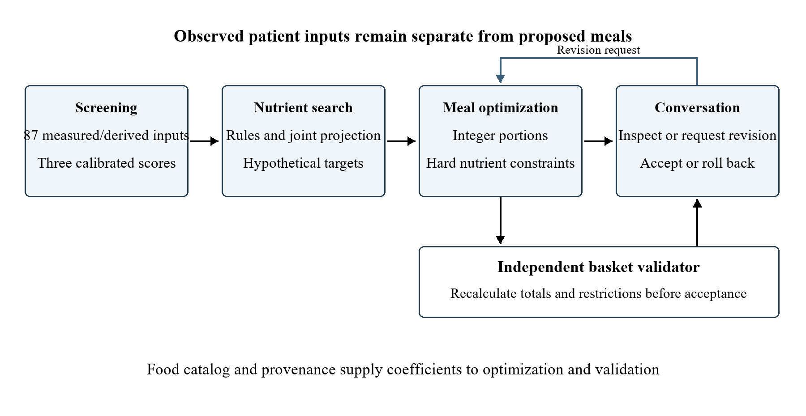
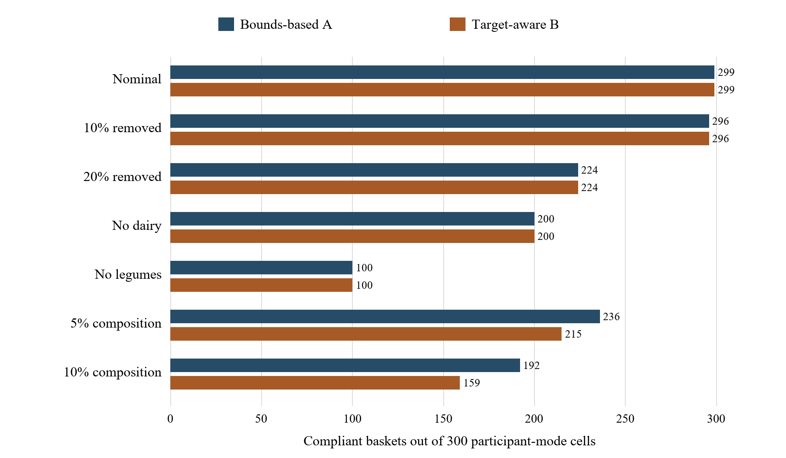

# BioNutriGPT An Auditable Framework for Cardiometabolic Screening and Constraint Preserving Conversational Meal Planning

**Abstract:** Nutrition assistants must distinguish predictive scores from feasible meals and verified conversational actions. BioNutriGPT integrates laboratory assisted cardiometabolic screening, constrained nutrient search, integer meal optimization and persistent conversational state. Six prediction models were evaluated on 7004 temporal NHANES participants. Evaluation included 600 nutrient search ablations, 800 input sensitivity tasks, 4200 meal robustness records and a separate Indian profile conversational study. The custom Transformer showed no overall predictive advantage. Removing joint projection reduced nutrient feasibility from 100 of 100 cases to 8. Target aware meal optimization improved target alignment but retained fewer compliant plans under composition perturbations. The guarded assistant passed 76 of 78 conversational turns; a matched comparison yielded 24 of 24 passes versus 2 for an unguarded language model. The contribution is an auditable evaluation of prediction, feasibility, robustness and revision as separate endpoints, without claiming clinical benefit.

**Keywords:** Nutrition decision support, Constraint optimization, Tabular learning, Robustness analysis, Conversational systems, Indian meal planning.

## 1. Introduction

Personalized nutrition software must translate information about a person into food choices that can be calculated, inspected and revised. Prediction, nutrient targeting, food selection and conversation are different computational tasks. A model can assign a lower disease probability to a hypothetical nutrient vector even when no available meal realizes that vector. A meal can meet nominal nutrient bounds yet fail when food composition changes. A conversational answer can sound reasonable while silently discarding an exclusion or changing an accepted plan without confirmation. Evaluating only predictive discrimination or fluent responses misses these failures.

Conversational nutrition recommendation is already established. ChatDiet combines personal and population information through an LLM orchestration framework [1]. Investigations of language-model nutrient estimation show why independently calculated composition remains necessary [2]. Recent work also translates dietary standards into complete meals and evaluates small ingredient substitutions [3]. These precedents mean that a chatbot, personalized food suggestions or a small-change objective alone cannot establish originality. The engineering problem addressed here is maintaining an explicit, testable boundary between a model score, a numerical prescription, an executable meal and an accepted conversational revision.

BioNutriGPT connects four components: cardiometabolic screening, constrained hypothetical nutrient search, discrete food optimization and controlled conversation. A food catalog supplies nutrient coefficients and provenance. A separate validator recalculates proposed meals before they become accepted state. The system retains observed patient values independently of hypothetical targets and revised food baskets. Screening and Indian meal planning are not treated as evidence of a single clinically validated intervention.

The contributions are threefold. First, the framework provides an auditable separation of prediction, nutrient feasibility, food realization and conversational acceptance. Second, matched comparisons, component removals and saved-record verification quantify which mechanisms contribute to numerical outcomes. Third, sensitivity analyses expose important trade-offs: target alignment can improve while composition robustness worsens, and reproducible nutrient search can remain locally sensitive. These are computational findings rather than claims of a new Transformer, a new integer-programming algorithm or demonstrated health improvement.

## 2. Related work

Integer and goal programming provide established methods for choosing food quantities under nutrient constraints. Aguilera Moreno studies user-defined serving granularity and continuous versus integer alternatives [4]. Chan and Tagkopoulos combine meal generation, portion adjustment and few-ingredient substitutions [3]. BioNutriGPT differs in its evaluation emphasis: it connects a screening component to nutrient-space search, tests transfer to discrete meals, and separately audits repeated conversational state changes. No superiority over these published systems is inferred from unmatched datasets or published point estimates.

Tabular deep learning must be compared with strong classical methods. Gorishniy et al. establish competitive neural baselines, including FT-Transformer [5], while CatBoost addresses categorical learning and prediction shift [6]. Ullah and Reddy investigate a related multimodal screening and recommendation setting [7]. Its population and endpoints differ from the present study, so its reported accuracy cannot be ranked against BioNutriGPT. Our six-model comparison and architecture ablations explicitly test whether added neural complexity is justified.

Counterfactual explanations describe changes in model predictions under altered inputs. Diverse counterfactual generation addresses feasibility and alternative explanations [8], while robustness research shows that inexpensive recourse can be unstable to input uncertainty [9]. BioNutriGPT does not estimate a structural causal model or an intervention effect. Its nutrient search produces hypothetical model inputs; a reduction in predicted probability does not establish a biological response to consuming the corresponding meal.

Table 1 summarizes the methodological overlap and the narrower distinction investigated here. Reporting draws on TRIPOD+AI for prediction studies [10] and TRIPOD-LLM for language-model evaluations [11]. These guidelines inform disclosure; their mention is not a certification of complete checklist compliance.

Table 1. Related approaches and the evaluation distinction

| Approach | Established capability | Distinction evaluated here |
|---|---|---|
| ChatDiet [1] | LLM-supported personalized food recommendation | Explicit proposal validation and persistent accepted-plan state |
| Nutrient-estimation evaluation [2] | Comparison of generated nutritional information with reference values | Catalog-based arithmetic is authoritative during revision |
| Meal generation and substitutions [3] | Dietary-target alignment with few ingredient changes | Cross-model nutrient rescoring and composition-robustness trade-offs |
| Integer goal programming [4] | Serving granularity and nutrient optimization | Target-source comparisons under shared constraints and budgets |
| Tabular and multimodal learning [5–7] | Prediction from heterogeneous structured inputs | No assumed neural advantage; calibrated matched comparisons |
| Counterfactual and robust recourse [8, 9] | Hypothetical input changes and stability analysis | Separation of score improvement from food feasibility and clinical effects |

## 3. Materials and methods

### 3.1 Study design and data

This is a retrospective prediction and computational systems study. NHANES provides the prediction data and adult profiles for the optimization experiments [12]. Development data from 2007–2016 contain 24136 participants; the temporal evaluation cohort from 2017–March 2020 contains 7004. Adults aged at least 20 are included to align with the cardiovascular questionnaire scope. The temporal period had previously been inspected during project development; it is not untouched prospective validation. Cohort lineage begins with the available merged survey files rather than a complete reconstruction of all originally eligible survey participants.

Table 2 gives partition and outcome counts. Diabetes is defined by reported diabetes or HbA1c at least 6.5 percent. A negative requires an observed below-threshold HbA1c and an eligible negative questionnaire response. Glucose is excluded from the primary phenotype because fasting ascertainment differs. Cardiovascular disease (CVD) is positive when any of five disease responses is positive; a negative requires all five to be negative. Missing responses cannot establish a negative. Obesity is defined by measured BMI at least 30 kg/m² and is a secondary exploratory outcome. These are study labels, not diagnoses made by the application.

Table 2. Analytic partitions and positive outcome counts

| Partition | Participants | Diabetes | Obesity | CVD |
|---|---:|---:|---:|---:|
| Training | 16894 | 2616 | 6427 | 1773 |
| Validation | 3621 | 562 | 1377 | 380 |
| Calibration | 3621 | 561 | 1377 | 379 |
| Temporal evaluation | 7004 | 1301 | 3057 | 845 |

An additional computational evaluation uses selected LASI Wave 1 Indian adult profiles [13]. The extraction contains 66859 merged records and 65368 eligible records after filtering; these are analytic extraction counts, not a claim about total LASI recruitment. One hundred selected profiles comprise 25 diabetes-only, 25 obesity-only, 25 CVD-only and 25 multimorbid cases, with 52 male and 48 female profiles across 29 states or union territories. This deliberately balanced sample is not nationally representative. LASI supplies anthropometry and reported diagnoses, not the complete measured dietary and laboratory feature set required for external prediction validation.

The food catalog used in the main planning evaluations contains 49 records: 20 INDB recipe variants and 29 USDA single-food proxies [14, 15]. Selected ingredient gaps use documented CoFID matches [16]. These records are not 49 laboratory-validated Indian cooked dishes. Portions are standardized gram-based modeling units, not independently validated household vessels. Six entries have missing values in active nutrient fields; such entries are excluded when those fields are required, rather than assigned zero. Forty-three complete entries before dietary-mode and preference filtering do not guarantee feasibility for every profile. Rule construction draws on nutritional references including Indian dietary guidance [17], but several limits remain project policies rather than endorsed clinical prescriptions.

### 3.2 Architecture and prediction component

Figure 1 shows the information flow. Structured form values or a TXT file enter a validated patient record. Screening produces three probabilities. The nutrient engine combines those probabilities with anthropometry and declared rules. The meal optimizer chooses discrete portions. The conversational service inspects the resulting basket or requests a new solve, while the validator controls acceptance. Proposed and accepted meals never overwrite measured patient inputs.

Figure 1. Information flow with separate observed inputs, candidate targets and accepted meal state. A revision returns to the optimizer and validator before acceptance.

The predictor has 87 features: five lipid measurements or derived lipid features, 39 dietary nutrient fields, seven dietary ratios, 19 lifestyle features and 17 demographic or missingness features. HbA1c and fasting glucose are not predictors. The supplementary predictor specification lists their exact names. Because lipids require laboratory measurements, the appropriate description is non-glycemic laboratory-assisted screening, not non-invasive screening. Feature transformations, imputation and scaling are fitted on training data only. Derived ratios are recomputed consistently at inference.

BioNutriGPT represents scalar features as 128-dimensional tokens with modality embeddings. A three-layer Transformer with four attention heads per layer is followed by modality-query pooling, a four-expert top-two routing module and three outcome heads. Logistic regression, histogram gradient boosting, CatBoost, an MLP and FT-Transformer provide comparators. Each family receives four predefined configurations. Selection uses validation mean AUROC for diabetes and CVD; obesity is reported separately. Equal configuration counts are not equal-compute tuning. Neural training uses AdamW, batch size 64, up to 40 epochs, early-stopping patience seven and gradient clipping at 1.0, with seed 42 and float32 precision. Neural outcome losses are averaged equally; the MoE auxiliary coefficient is 0.01. The selected BioNutriGPT learning rate is 0.0003 with weight decay 0.001. Calibration fits an unpenalized logistic model to clipped raw logits for each outcome using only the reserved calibration partition. Five architecture variants over five seeds evaluate component contributions independently of the single-seed family comparison.

### 3.3 Constrained nutrient search

Let x denote observed features, n the 39 proposed nutrient values and p_j(n; x) the frozen calibrated score for outcome j after replacing dietary features and recomputing ratios. Anthropometry, demographic fields and laboratory observations remain unchanged during this search. Energy targets use anthropometry and activity; a fixed obesity-score cutoff of 0.5 activates a 500-kcal reduction subject to a 1200-kcal floor. The same descriptive 0.5 cutoff is used for the other outcome-dependent rules. These operating points are not validated treatment thresholds.

The model-guided search performs 50 Adam steps at learning rate 0.05. Equation (1) gives the objective, where n₀ is observed intake, pⱼ₀ is the baseline score and B is the implemented bound penalty.

J(n) = 2p_CVD + 2p_diabetes + p_obesity + 50Σⱼmax(0, pⱼ − pⱼ₀) + 0.001‖n − n₀‖₂² + B(n).    (1)

Box clipping is followed by projection into the coupled feasible region. Projection uses fixed engineering scales, an LP feasibility witness and SLSQP; a checked LP solution can be used as a fallback. Numerical checks cover bounds, energy and ratio rules. A separate score gate requires each probability change to be no greater than 0.0015. Overall acceptance requires both numerical and score-gate acceptance. The score gate is partly self-referential because the same model guides optimization.

A matched 100-participant comparison evaluates rules-only target construction, minimum-change projection of observed intake and model-guided search followed by projection. All three share baseline scores, routing, energy and final acceptance checks; rules-only therefore does not mean model-free. A separate 100-participant study evaluates the full search and removal of the model objective, change penalty, barrier, joint projection, or sequential filters. Filters 1–3 are removed together, not individually. These six conditions yield 600 optimizations.

The 600 saved proposals are rescored by frozen BioNutriGPT, CatBoost and FT-Transformer, with no fitting or target regeneration. One hundred baseline rows plus 600 proposals give 700 evaluated rows per model, not necessarily 700 distinct vectors. Shared development data mean that architectural agreement is not independent-cohort validation. On the same ablation cohort, eight stability conditions produce 800 records: baseline, identical-input repeat, dietary scaling by minus/plus 1 and 5 percent, and measured lipid scaling by minus/plus 5 percent. Derived features are recomputed. The three-person development pilot is excluded from full-cohort estimates. These are chosen engineering stresses, not measured error distributions.

### 3.4 Discrete meal optimization

For food i, qᵢ is an integer number of standardized portions, zᵢ indicates selection, and aₖᵢ is nutrient k per portion. The evaluated formulation uses qᵢ in {0, 1, 2, 3}, linking constraints zᵢ ≤ qᵢ ≤ 3zᵢ, four to eight dishes unless a supported tighter limit is requested, and dietary-mode category rules. Thirty nutrient fields are active; seven are report-only and caffeine/alcohol are tracked separately as exposures. Active nutrient bounds are hard constraints:

Lₖ ≤ Σᵢaₖᵢqᵢ ≤ Uₖ, for every active k.    (2)

Two objectives use the same feasible region. The bounds-based objective A penalizes selection cost and calorie deviation. Target-aware objective B additionally penalizes normalized absolute deviation from Stage 2 nutrient targets. Equation (3) defines B, with selection weight γ=0.10 and target weight λ=1 in the robustness study, fixed scales sₖ and eligible non-energy nutrients K. Energy is penalized separately and not counted twice.

J_B(q) = γΣᵢcᵢzᵢ + (150/T_E)|Σᵢa_Eᵢqᵢ − T_E| + λΣₖ∈K(wₖ/sₖ)|Σᵢaₖᵢqᵢ − Tₖ|.    (3)

Absolute deviations are linearized; they cannot purchase violations of Eq. (2). Costs are engineering selection preferences, not verified retail prices. HiGHS is called through SciPy MILP [18]. An independent basket check reconstructs totals, category restrictions and integrality. Solver termination within a configured gap is not described as proof of an exact optimum.

A matched budget study contains 5400 solves: 100 participants, three target sources, three dietary modes, two objectives and three limits of 3, 5 and 10 seconds. The robustness extension reuses these 100 participants and the model-guided targets with a five-second budget. Five solve scenarios are evaluated: nominal catalog, 10-percent and 20-percent food removals, dairy exclusion with zero dairy permitted, and legume exclusion. Two objectives and three modes give 3000 solves. Fixed nominal baskets are then replayed under two composition perturbations, giving another 1200 records. Thus, 4200 records are not 4200 independent participants or optimizer calls.

For each perturbation severity, a fixed per-food proportional draw scales known coefficients within minus/plus 5 or 10 percent and is shared across participants and objectives. Unknowns remain unknown. Scaling preserves existing catalog relationships; it does not impose exact equality between listed energy and macronutrient-derived energy. Replays test whether a nominal basket remains compliant without re-optimization. A missing nominal plan remains unavailable rather than becoming an invented nutrient violation.

### 3.5 Conversational state and Indian profile evaluation

The guarded assistant routes requests to explicit tools for nutrient inspection, exclusions, revision, acceptance and rollback. Numerical responses use catalog calculations. A proposal is bound to the active basket and recorded restrictions. Acceptance requires a server-stored proposal and a fresh validation; rollback restores an earlier accepted basket without erasing later patient-level allergy declarations. Incomplete allergen annotations prevent an allergen-free safety claim. Daily food locks do not independently establish meal-slot preservation.

The comparative dialogue experiment evaluates a deterministic tool-backed assistant against a solver-free Qwen 2.5 3B Instruct model. It is not an otherwise identical LLM-agent comparison. Qwen uses four-bit NF4 quantization, float16 computation, double quantization, greedy decoding, 512 maximum new tokens and repetition penalty 1.03 on an RTX 3050 Laptop GPU. The prompt supplies identical eligible-food coefficients, bounds, engineering costs and cumulative restrictions. Complete-data prompt catalogs contain 37 vegetarian foods and 43 foods in the other modes. No unconstrained prose rewriting is allowed to override verified numerical responses.

LASI-derived planning uses reported diagnoses to construct rule-based flags rather than Stage 1 predictions. Activity is assumed sedentary, energy uses an anthropometric equation and BMI-based routing, and unavailable dietary baselines are rule-derived; sodium/potassium baselines are set to 2800/2600 mg. These assumed quantities are not observed LASI intake. Each of 100 profiles is evaluated in three modes, yielding 300 solves. This evaluates adapted rules and planning, not the full model-guided nutrient search or Indian prediction validity.

The dialogue cohort contains 36 distinct initially feasible profiles, nine per disease stratum and 12 per dietary mode. Each guarded condition has 78 turns. A matched 12-profile subset provides 24 turns for comparison with Qwen. Revision solves have two-second limits; a separate three-second feasibility oracle distinguishes feasible, reported-infeasible and unresolved requests. Timeouts count as protocol failures. Protocol success includes valid revisions, justified refusals, grounded answers or exact restoration, as appropriate; it is not synonymous with proposal generation. Nutrient-answer checks use a five-percent relative or 0.3 absolute tolerance and are not exhaustive semantic hallucination tests.

### 3.6 Statistical analysis and verification

The prediction family comparison uses 20000 paired participant bootstrap resamples, with adjusted intervals across 20 primary diabetes/CVD AUROC and calibrated-Brier contrasts. This analysis was specified after inspecting point estimates and is not preregistered confirmatory evidence. The distinct prediction-robustness audit uses 10000 shared participant resamples: 2688 interval pairs, or 5376 endpoints, were reproduced by a separate tied-score pair-counting AUROC implementation. It is therefore incorrect to describe every prediction analysis as a 10000-replicate study. These resampling analyses are conditional on frozen models, not training-seed uncertainty.

Robustness includes whole dietary, whole lipid and combined missingness; 20-percent dietary-cell loss at two seeds; and dietary, lipid and joint noise. Training-derived imputation and missingness flags are retained, and labels remain fixed. The selected complete-record cohort and simulated loss do not reproduce natural nonrandom missingness. A separate survey sensitivity uses dietary weights and stratified delete-PSU jackknife uncertainty; unweighted participant bootstrap intervals do not substitute for the complex survey design.

For Stage 2 and Stage 3 continuous outcomes, paired percentile intervals use 10000 participant resamples. Stage 3 averages available dietary modes within each participant before aggregation; three modes are not independent observations. Target-error contrasts condition on jointly valid baskets. Stage 2 ablations adjust five primary acceptance tests with Holm's method. Stage 3 robustness adjusts 21 within-mode exact paired acceptance tests with Holm's method; displayed bootstrap intervals are exploratory and pointwise. A retrospective all-rule audit separately reproduces 94 margin intervals. Confidence intervals spanning zero do not establish equivalence.

Dialogue intervals use 1000 scenario-level resamples. Change magnitude is additionally evaluated on 25 successful pairs with identical preceding state; this conditional comparison is not randomized evidence of user acceptability. All-success bootstrap intervals can degenerate and must not be read as certainty. Separate verification reconstructs arithmetic and reproduces statistics, but some preprocessing and rule helpers are shared. This verifies the recorded computation, not the clinical appropriateness of the policy.

## 4. Results and discussion

### 4.1 Prediction performance and missing-input sensitivity

Table 3 reports the six-model temporal comparison. BioNutriGPT does not establish an overall advantage. CatBoost has the highest diabetes and obesity AUROC point estimates; FT-Transformer has the highest CVD estimate. BioNutriGPT calibrated Brier scores are 0.120914, 0.204624 and 0.087353 for diabetes, obesity and CVD. Five-seed ablations do not demonstrate an adjusted primary benefit from the added architectural components. Removing the expert module reduces parameter count from 1295623 to 700675 without an established primary disadvantage; absence of detected benefit is not equivalence.

Table 3. Temporal discrimination on 7004 participants

| Model | Diabetes AUROC | Obesity AUROC | CVD AUROC |
|---|---:|---:|---:|
| Logistic regression | 0.7965 | 0.7445 | 0.8291 |
| Histogram gradient boosting | 0.8124 | 0.7557 | 0.8252 |
| CatBoost | 0.8138 | 0.7578 | 0.8288 |
| MLP | 0.7996 | 0.7519 | 0.8275 |
| BioNutriGPT | 0.8107 | 0.7467 | 0.8288 |
| FT-Transformer | 0.8109 | 0.7539 | 0.8350 |

Missing lipids causes a larger diabetes discrimination loss than the selected small-noise conditions (Table 4). With both modalities missing, BioNutriGPT diabetes AUROC falls from 0.8107 to 0.7441. Across the 32 reported diabetes/CVD AUROC robustness contrasts, two pointwise intervals favor BioNutriGPT; Brier contrasts have mixed directions. These exploratory findings do not establish a general robustness advantage. Aggregate discrimination can also conceal individual threshold changes: missing dietary inputs changes 12.78 percent of BioNutriGPT obesity classifications at 0.5.

Table 4. BioNutriGPT diabetes robustness with paired deterioration intervals

| Condition | AUROC | AUROC loss and 95% CI | Brier score |
|---|---:|---|---:|
| Baseline | 0.8107 | Reference | 0.120914 |
| Dietary modality missing | 0.8008 | 0.0099 [0.0061, 0.0137] | 0.124530 |
| Lipid modality missing | 0.7607 | 0.0500 [0.0419, 0.0578] | 0.132341 |
| Both modalities missing | 0.7441 | 0.0666 [0.0577, 0.0754] | 0.134954 |
| Joint input noise | 0.8094 | 0.0013 [0.0002, 0.0023] | 0.121111 |

Survey-weighted sensitivity gives BioNutriGPT AUROCs of 0.8402 for diabetes, 0.7330 for obesity and 0.8468 for CVD. These weighted estimates answer a different analytic question and are not interchangeable with Table 3. Weighting does not undo analytic selection. Survey calibration identifies average obesity underprediction; decision curves remain hypothetical further-assessment analyses because known diagnoses and prevalent CVD are included. Neither analysis establishes that screening improves meal-planning outcomes in India.

### 4.2 Nutrient targeting and component contributions

In the matched target-construction cohort, all methods pass numerical constraints. Overall numerical-plus-score acceptance is 48/100 for rules-only, 70/100 for minimum-change and 77/100 for model-guided search. The primary model-guided versus minimum-change difference is 7 percentage points, with 95-percent interval 2 to 13 and exact paired p=0.0391. Model-guided search also adds mean normalized displacement of 0.2717, with interval 0.2325 to 0.3153. This measures an optimization trade-off, not palatability or improved health.

The separate ablation cohort yields Table 5. Removing joint projection decreases numerical acceptance from 100/100 to 8/100 and overall acceptance from 62/100 to 7/100. The overall difference is minus 55 percentage points, interval minus 65 to minus 45, with Holm-adjusted p=2.78×10⁻¹⁶. Removing the model objective reduces overall acceptance by 13 percentage points, interval minus 20 to minus 7, with adjusted p=0.000977. Different cohort membership explains why the full reference has 62 acceptances here rather than 77 in the three-method comparison.

Table 5. Nutrient-search ablations on a separate 100-participant cohort

| Condition | Numerical pass | Overall acceptance | Mean normalized displacement |
|---|---:|---:|---:|
| Full reference | 100/100 | 62/100 | 8.6427 |
| Without model objective | 100/100 | 49/100 | 7.5015 |
| Without change penalty | 100/100 | 64/100 | 9.5591 |
| Without barrier penalty | 100/100 | 65/100 | 8.4803 |
| Without joint projection | 8/100 | 7/100 | 8.4644 |
| Without sequential filters | 100/100 | 62/100 | 8.6427 |

Removing the change penalty increases displacement by 0.9164, interval 0.6847 to 1.1650. Sequential-filter removal produces identical outputs in this sample; it does not justify removing final validation or establish each filter's individual effect. The barrier shows no adjusted acceptance advantage, although its removal changes mean displacement. The numerical projection, the objective and the validation gate therefore serve distinct functions.

Frozen rescoring reveals outcome-dependent agreement (Table 6). Mean obesity and CVD probabilities decrease under all three scorers, while diabetes decreases under BioNutriGPT, increases under CatBoost and has an interval spanning zero under FT-Transformer. The comparison cannot rule out exploitation of shared or model-specific response surfaces. It is especially inappropriate to interpret the source-model score decrease as a diabetes treatment effect.

Table 6. Mean score changes for full-reference proposals on 100 participants

| Frozen scorer | Diabetes change [95% CI] | Obesity change | CVD change |
|---|---|---:|---:|
| BioNutriGPT | −0.0098 [−0.0143, −0.0054] | −0.0414 | −0.0068 |
| CatBoost | +0.0132 [+0.0061, +0.0207] | −0.0317 | −0.0051 |
| FT-Transformer | −0.0024 [−0.0113, +0.0067] | −0.0345 | −0.0083 |

All 800 input-sensitivity records meet numerical checks, and identical-input repeats match in the tested environment. This does not establish local stability. One-percent dietary scaling changes a B2 target from 2.7169 to 1.2920 mg in one case and a B12 target from 5.3191 to 2.8101 micrograms in another. These discrepancies are already present after Adam and box clipping, before joint projection, without routing crossings or solver fallback. Exact gradient-level causes cannot be established from the saved trajectories. Lipid perturbations cause six and five routing crossings respectively, with calorie-budget increases reaching 500 kcal. Reproducibility, numerical feasibility and input stability must therefore remain separate claims.

### 4.3 Meal target attainment and robustness

At five seconds in the matched budget study, both objectives return 897/900 valid participant-mode-target cells. An observed zero difference does not establish population equivalence. Longer budgets do not uniformly increase accepted-plan counts, although target-aware optimization improves target-error point estimates among joint successes. A solver's configured relative-gap tolerance limits optimality claims.

Table 7 and Fig. 2 summarize the robustness extension. Both objectives have identical observed acceptance under nominal conditions, food removals and exclusions. The target-aware objective reduces normalized target error among jointly valid outputs; under nominal conditions the mean paired difference is −0.4877, with interval −0.5122 to −0.4629. Its arithmetic compliance under composition perturbations is nevertheless lower: 215/300 versus 236/300 at five percent and 159/300 versus 192/300 at ten percent.

Table 7. Meal robustness over 100 participants and three dietary modes

| Scenario | Bounds-based A | Target-aware B | Acceptance difference B−A, pp [95% CI] |
|---|---:|---:|---|
| Nominal | 299/300 | 299/300 | 0.00 [0.00, 0.00] |
| Remove 10% of foods | 296/300 | 296/300 | 0.00 [0.00, 0.00] |
| Remove 20% of foods | 224/300 | 224/300 | 0.00 [0.00, 0.00] |
| Exclude dairy | 200/300 | 200/300 | 0.00 [0.00, 0.00] |
| Exclude legumes | 100/300 | 100/300 | 0.00 [0.00, 0.00] |
| Composition perturbation 5% | 236/300 | 215/300 | −7.00 [−14.00, 0.00] |
| Composition perturbation 10% | 192/300 | 159/300 | −11.00 [−19.67, −2.33] |

Figure 2. Accepted or compliant baskets out of 300 participant-mode cells. Composition results replay nominal baskets without re-optimization; other scenarios invoke the optimizer.

The pooled participant-level intervals are exploratory. Within-mode exact tests do not survive the declared 21-test Holm correction; the lowest adjusted p is approximately 0.279. This distinction prevents a pointwise interval from being reported as multiplicity-adjusted confirmation. Target-error comparisons under perturbation also condition on continued joint feasibility: 90 participants contribute at five percent and 75 at ten percent. Their apparent alignment advantage cannot be generalized to all attempted cases.

All-rule reconstruction agrees with the saved acceptance classifications for all 4200 records. The audit attributes nominal and removal failures to reported infeasible active rules, not timeout. Dairy exclusion fails for 100 pure-vegetarian cases; this does not establish the minimal conflicting nutrient set. Legume exclusion removes a mandatory category in vegetarian and mixed modes, producing a structural conflict. These failures should not be described as language-model hallucinations or universal nutritional impossibility.

Constraint margins further qualify the trade-off (Table 8). Target-aware baskets have smaller nominal margins for PUFA upper bounds and folate lower bounds, accompanied by more violations under the fixed ten-percent draw. Potassium shows the opposite pattern. Counts overlap because a basket can violate several rules. This is evidence of rule-specific vulnerability, not a universal mechanism that every target-aware plan lies closer to every bound.

Table 8. Selected violations under ten-percent composition perturbation

| Rule | Bounds-based A | Target-aware B |
|---|---:|---:|
| PUFA upper bound | 19 | 39 |
| Folate DFE lower bound | 1 | 16 |
| Niacin lower bound | 9 | 16 |
| Energy upper bound | 2 | 14 |
| Potassium upper bound | 21 | 3 |
| Carbohydrate upper bound | 15 | 20 |

### 4.4 Indian profiles and conversational revision

The LASI profile study accepts 91/100 vegetarian, 96/100 mixed and 98/100 non-vegetarian plans. The selected demographic and diagnostic profiles strengthen the relevance of testing Indian planning inputs, but do not validate the U.S.-trained screening model or represent national performance. Rule-derived missing inputs remain assumptions.

Across 78 guarded conversational turns, 76 pass the protocol (97.44 percent; scenario-cluster bootstrap 95-percent interval 93.67 to 100 percent). Of 42 revision requests, 29 produce validated proposals and 11 receive justified infeasibility refusals; two timeout-related failures remain, including one request classified feasible by the oracle. No invalid proposal is recorded in this set. Success includes refusing an infeasible request rather than fabricating a replacement meal. Acceptance, exclusion retention and exact rollback are evaluated as state transitions, not inferred from friendly wording.

Table 9 gives the matched comparison. Supplying the same catalog and numerical rules makes information access comparable, but the systems have different capabilities: the guarded service invokes an optimizer and validator, while Qwen generates responses without these tools. The result supports this architectural separation under the tested requests, not a general ranking of language models.

Table 9. Matched conversational evaluation on 12 profiles and 24 turns

| Endpoint | Guarded assistant | Solver-free Qwen |
|---|---:|---:|
| Protocol passes | 24/24 | 2/24 |
| Valid proposals on feasible requests | 9/9 | 0/9 |
| Invalid generated proposals | 0 | 8 |

The revision change penalty reduces mean serving changes from 16.56 to 7.72 among 25 successful pairs with identical input state, a descriptive reduction of 53.38 percent. The corresponding restricted analysis avoids attributing differences in prior accepted state to the penalty. It still does not measure taste, convenience, dietary adherence or participant preference. The evaluation is selected, scripted and English-language; a successful rollback test is not evidence of unrestricted conversational understanding.

### 4.5 Interpretation and limitations

The primary contribution is an inspectable engineering framework and its disaggregated evidence. Screening accuracy, nutrient-space feasibility, food-space acceptance, robustness and dialogue completion answer different questions. The strongest component evidence supports joint constraint projection; the strongest system-level evidence supports separating generated requests from numerical acceptance. Neither requires claiming that the custom Transformer dominates simpler methods.

The results also identify limits that remain in the final system. The model-score objective is associational, external Indian prediction validity is unestablished, and some small input changes produce substantial target differences. Food proxies, recipe variability and incomplete allergen annotation restrict the meaning of numerical acceptance. Whole portions are a structural property, not proof of household acceptability. Composition perturbations use one fixed draw per severity and cannot estimate the distribution of real cooking or assay errors. Reusing cohorts across related experiments limits independent replication, while conditional joint-success analyses can favor easier cases.

No prospective intervention, dietitian rating study or longitudinal health outcome is reported. Renal disease management, pregnancy, pediatric prescribing and medication adjustment lie outside the supported scope. Survey weights do not make selected optimization or conversational cohorts representative. The evidence supports further engineering evaluation and expert-supervised investigation, rather than autonomous clinical deployment. These limitations are findings and scope boundaries, not hidden exceptions to a claim of universal correctness.

## 5. Conclusion

BioNutriGPT separates cardiometabolic prediction, constrained nutrient search, discrete meals and accepted conversational state within an auditable workflow. Matched experiments show that joint projection supports numerical feasibility and that explicit validation supports controlled revisions. They also show that the custom Transformer has no established overall predictive advantage, model-score improvements can disagree across scorers, and better nutrient-target alignment can coexist with weaker composition robustness. The framework therefore contributes a reproducible way to evaluate these trade-offs rather than a claim of clinically proven precision nutrition. The reported evidence supports computational feasibility under declared rules while preserving clear boundaries around causal effects, Indian prediction validity and patient acceptability.

## Data availability

NHANES source data are available from NCHS [12]. LASI access follows the data provider's requirements [13]. Food-composition sources are identified in references [14–16]. Participant-level records, prompts containing clinical profiles and access-controlled source files are not redistributed with this manuscript. Aggregate tables and figure data accompany the manuscript. No public code-release identifier is claimed here.

## Use of artificial intelligence tools

AI assistants, including OpenAI Codex and Google Gemini, assisted software development, evidence organization and manuscript preparation. Generated text and code are not substitutes for author responsibility or experimental records. The measured Qwen outputs are part of the conversational experiment and are distinguished from manuscript-writing assistance.

## References

[1] Z. Yang, E. Khatibi, N. Nagesh, M. Abbasian, I. Azimi, R. Jain, et al., “ChatDiet: Empowering personalized nutrition-oriented food recommender chatbots through an LLM-augmented framework”, Smart Health, Vol. 32, article 100465, 2024. doi: 10.1016/j.smhl.2024.100465.

[2] M. Haman, M. Školník, and M. Lošťák, “AI dietician: Unveiling the accuracy of ChatGPT's nutritional estimations”, Nutrition, Vol. 119, article 112325, 2024. doi: 10.1016/j.nut.2023.112325.

[3] T. Chan and I. Tagkopoulos, “Translating dietary standards into healthy meals with few-ingredient substitutions”, PLOS Digital Health, Vol. 5, No. 5, article e0001367, 2026. doi: 10.1371/journal.pdig.0001367.

[4] F. Aguilera Moreno, “Mixed Integer Goal Programming for Personalized Meal Optimization with User-Defined Serving Granularity”, arXiv preprint, 2026. doi: 10.48550/arXiv.2605.13849.

[5] Y. Gorishniy, I. Rubachev, V. Khrulkov, and A. Babenko, “Revisiting Deep Learning Models for Tabular Data”, In: Proc. of Advances in Neural Information Processing Systems, Vol. 34, 2021. [Online]. Available: https://arxiv.org/abs/2106.11959.

[6] L. Prokhorenkova, G. Gusev, A. Vorobev, A. V. Dorogush, and A. Gulin, “CatBoost: Unbiased boosting with categorical features”, In: Proc. of Advances in Neural Information Processing Systems, Vol. 31, 2018. [Online]. Available: https://proceedings.neurips.cc/paper/2018/hash/14491b756b3a51daac41c24863285549-Abstract.html.

[7] M. T. Ullah and E. S. Reddy, “Calibrated Risk Assessment for Perimenopause and Practical Clinical Triage Utilizing Explainable Multimodal Learning”, International Journal of Intelligent Engineering and Systems, Vol. 19, No. 5, pp. 592–605, 2026. doi: 10.22266/ijies2026.0531.34.

[8] R. K. Mothilal, A. Sharma, and C. Tan, “Explaining Machine Learning Classifiers through Diverse Counterfactual Explanations”, In: Proc. of the Conference on Fairness, Accountability, and Transparency, 2020. [Online]. Available: https://arxiv.org/abs/1905.07697.

[9] R. Dominguez-Olmedo, A. H. Karimi, and B. Schölkopf, “On the Adversarial Robustness of Causal Algorithmic Recourse”, In: Proc. of the 39th International Conference on Machine Learning, PMLR, Vol. 162, pp. 5324–5342, 2022.

[10] G. S. Collins, K. G. M. Moons, P. Dhiman, R. D. Riley, A. L. Beam, B. Van Calster, et al., “TRIPOD+AI statement: updated guidance for reporting clinical prediction models that use regression or machine learning methods”, BMJ, Vol. 385, article e078378, 2024. doi: 10.1136/bmj-2023-078378.

[11] J. Gallifant, M. Afshar, S. Ameen, Y. Aphinyanaphongs, S. Chen, G. Cacciamani, et al., “The TRIPOD-LLM reporting guideline for studies using large language models”, Nature Medicine, Vol. 31, No. 1, pp. 60-69, 2025. doi: 10.1038/s41591-024-03425-5.

[12] National Center for Health Statistics, “NHANES questionnaires, datasets, and related documentation”. [Online]. Available: https://wwwn.cdc.gov/nchs/nhanes/continuousnhanes/default.aspx?Cycle=2017-2020.

[13] A. Perianayagam, D. Bloom, J. Lee, S. Parasuraman, T. V. Sekher, S. K. Mohanty, et al., “Cohort Profile: The Longitudinal Ageing Study in India (LASI)”, International Journal of Epidemiology, Vol. 51, No. 4, pp. e167-e176, 2022. doi: 10.1093/ije/dyab266.

[14] A. Vijayakumar, H. B. Dubasi, A. Awasthi and L. M. Jaacks, “Development of an Indian Food Composition Database”, Current Developments in Nutrition, Vol. 8, No. 7, article 103790, 2024. doi: 10.1016/j.cdnut.2024.103790.

[15] United States Department of Agriculture, “FoodData Central data documentation”. [Online]. Available: https://fdc.nal.usda.gov/data-documentation/.

[16] Public Health England, “McCance and Widdowson's Composition of Foods Integrated Dataset”, 2021. [Online]. Available: https://www.gov.uk/government/publications/composition-of-foods-integrated-dataset-cofid.

[17] ICMR–National Institute of Nutrition, Dietary Guidelines for Indians, 2024. [Online]. Available: https://www.nin.res.in/dietaryguidelines/pdfjs/locale/DGI24thJune2024fin.pdf.

[18] SciPy developers, “scipy.optimize.milp”. [Online]. Available: https://docs.scipy.org/doc/scipy/reference/generated/scipy.optimize.milp.html.
