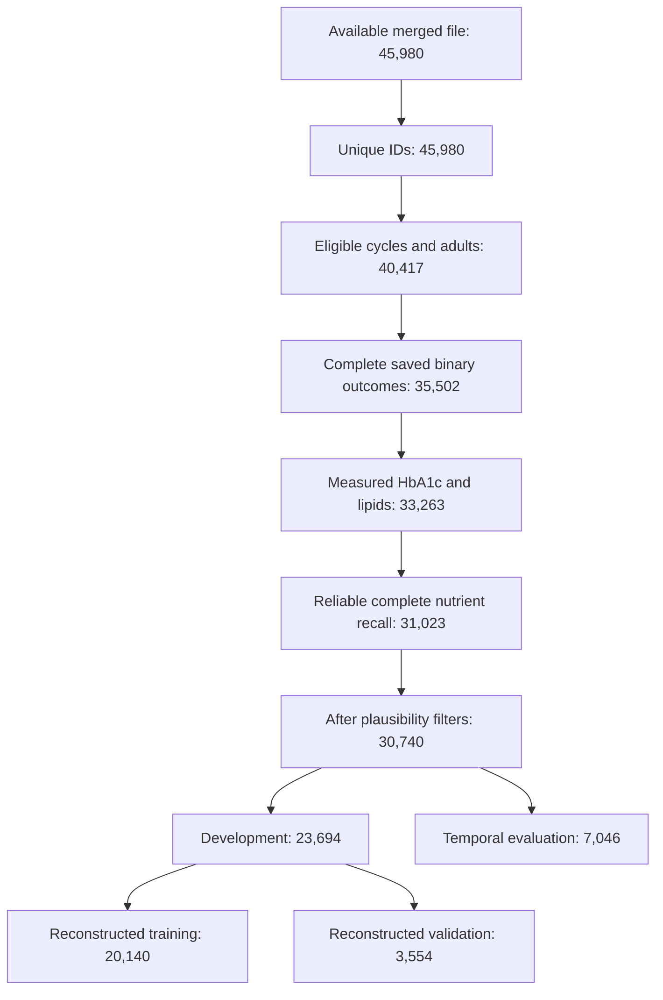

# Stage 1 foundation audit — 2026-11-18

**Conclusion: cohort reproduction passes, but outcome-definition inconsistency and evaluation leakage block a clean Stage 1 comparison. Audit completed; scientific repairs are pending.** No production data, weights, preprocessing artifacts or thresholds were changed.

## Verified findings

| Check | Result |
|---|---|
| Raw-to-clean reproduction | Both saved clean cohorts reproduce within numerical tolerance from the available merged raw file |
| Clean-to-ML reproduction | Both 87-feature files reproduce with the saved preprocessing artifact |
| Development / temporal overlap | Zero participant IDs overlap; no duplicate IDs in either cohort |
| Direct outcome-defining predictors | No HbA1c, glucose, BMI, height/weight or diagnosis fields in the 87 model predictors |
| Original development source | The merge script's Models/P/BioNutriGPT_final_dataset_2005_2018.csv is absent; lineage before the merged raw file remains unverified |
| Original split provenance | Current code deterministically reconstructs 20,140 training and 3,554 validation rows, but the weights-only checkpoint cannot attest original membership |

## 1. Outcome definitions differ across development and temporal evaluation — blocking

Applying the existing temporal outcome definition to selected development participants changes 910 diabetes-negative labels to positive and 225 CVD-negative labels to positive. Obesity has zero discrepancies. All temporal labels reproduce their own definition.

The selected development diabetes labels match diagnosis-only status exactly; the development CVD labels match the four-condition composite excluding heart failure exactly. This is empirical equivalence, not proof of the missing original label-generation code. All 910 diabetes disagreements report no diabetes but meet an included laboratory criterion. All 225 CVD disagreements report heart failure. Thus, this is a substantive endpoint mismatch, not a formatting error.

Required repair: explicitly choose and version common outcomes, rebuild labels consistently for all cycles, reconsider eligibility, and retrain/re-evaluate on the corrected cohorts. Do not silently overwrite historical datasets or retain their performance as the new primary evaluation. Existing results may remain descriptive historical evidence with the mismatch disclosed.

## 2. Internal preprocessing leakage — blocking for repaired comparisons

The saved scaler saw all 23,694 development participants, including the later 3,554 internal validation participants. Re-fitting the current preprocessor on the entire development clean file exactly reproduces its means, scales, medians, modes, log-column selection and clipping bounds. No temporal-test fitting was detected by this reconstruction, but internal validation was exposed to preprocessing statistics.

Required repair: split before fitting imputation, skew selection, clipping and scaling. Fit on model-training rows only, then transform validation/calibration/test separately. Refitting a preprocessor alone cannot repair already trained weights.

## 3. Calibration split contamination — blocking

Training uses diabetes-stratified splitting with an integer validation size of 3,554. The evaluation script instead uses an unstratified 15% split producing 3,555 calibration rows. Of those, 2,997 belong to reconstructed model-training rows and only 558 to reconstructed validation rows. Its logistic recalibration fits probabilities, not logits. Baselines are fitted on all 23,694 development rows, unlike the Transformer's 20,140 training rows.

Required repair: common explicit partitions, reserved or out-of-fold calibration predictions, and consistent comparison budgets. Even the original validation set was used for early stopping, so it should not be casually relabelled an independent calibration set.

## 4. Partial composite ascertainment — decision and sensitivity analysis required

Among saved diabetes negatives, 10,673 development and 2,967 temporal participants lack at least one of HbA1c, glucose or a valid yes/no diagnosis response. All development negatives have HbA1c and a valid diagnosis response; 147 temporal negatives lack a valid diagnosis response despite measured HbA1c. Missing fasting glucose is not automatically a labelling error: requiring it would change the target cohort and sampling design. Specify an ascertainment policy rather than indiscriminately deleting all these participants.

For CVD, 110 development and 41 temporal negatives lack at least one valid component response. Prespecify a strict negative rule (all required components observed negative) and compare against the observed-components convention. Report the resulting cohort and prevalence changes. Positive-any-component labels and negative-all-components labels need different missingness treatment.

## 5. Deployment and interpretation issues — repairs pending

- Inference thresholds 0.617/0.445/0.603 are documented in source as selected using temporal evaluation. They cannot support unbiased threshold-performance claims.
- Training and artifact feature orders differ, but contain identical names. Training selects columns by model names; order difference alone is not an error.
- The backend accepts an engineered 87-feature vector, and named input fills omitted fields with application defaults. The normalizer applies log/clip/scale to supplied engineered fields; this is not the complete clean-data imputation/derivation/encoding pipeline. Full form/TXT-to-model parity remains unverified and must be tested before deployment equivalence is claimed.
- The standalone inference helper guesses raw versus normalized input from positional magnitudes. An explicit input representation is preferable.
- Derived ratios use lipids/diet/sleep, not outcome-defining measurements in inspected formulas. This does not establish absence of all selection bias or semantic leakage.
- HbA1c remains an eligibility measurement despite its exclusion from predictors. Scope remains laboratory-assisted screening.
- Existing temporal results were inspected during development. Indian Stage 1 predictive validity remains unestablished.

## Reproduced cohort flow

The first available raw file is already an upstream selected/merged dataset; this flow is not a complete NHANES source-population flow. The 5,563 exclusion combines age and cycle rules as implemented. Component outcome missingness by cycle and clean predictor missingness are provided as separate CSVs. Sentinel replacement counts are in the JSON report; replacing missing codes in predictors does not fix composite-label ascertainment.

## Outcome counts (positive / negative)

| Partition | N | Diabetes | Obesity | CVD |
|---|---:|---:|---:|---:|
| Development | 23,694 | 3,022 / 20,672 | 8,932 / 14,762 | 2,205 / 21,489 |
| Reconstructed training | 20,140 | 2,569 / 17,571 | 7,596 / 12,544 | 1,889 / 18,251 |
| Reconstructed validation | 3,554 | 453 / 3,101 | 1,336 / 2,218 | 316 / 3,238 |
| Temporal | 7,046 | 1,409 / 5,637 | 3,075 / 3,971 | 845 / 6,201 |

## Deliverables and next action

The audit script is `audit_stage1_foundation.py`. This folder contains machine-readable findings and source hashes, cohort flow, partition counts, clean-input missingness, component missingness by cycle, outcome disagreements and sensitivity counts. `reconstructed_split_membership_LOCAL.csv` stores reconstructed IDs and original row positions; it is not added to the submission pack. Input hashes were checked unchanged after execution.

Next independent task: prepare a versioned label/cohort repair with explicitly harmonized endpoints and missingness policies, then freeze new partitions and fit preprocessing only on training rows. Obtain approval before a new long model-training/comparison run as requested. The earlier submission ZIP predates these findings and should not be submitted as current without reconciliation.
