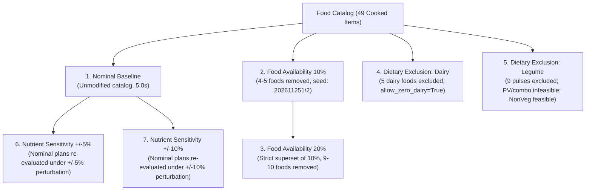

# Stage 3 Robustness Evaluation Protocol (v1)

## Executive Summary & Research Objective

This document defines the frozen experimental protocol for the **controlled engineering robustness evaluation** of the Stage 3 target-aware meal optimizer in BioNutriGPT.

The primary research question is:
> **Does the experimental target-aware optimizer ($\lambda_{\text{target}}=1.0$) remain reliable under food unavailability, dietary exclusions, and nutrient-data perturbations, compared with the existing bounds-based objective?**

---

> [!IMPORTANT]
> **Scope & Status: Preparation Only**
> This task comprises the preparation and frozen specification of the protocol, scenario generator, research runner, independent reconstructive verifier, and synthetic tests.
> **The full 100-participant benchmark has NOT been executed.**
> This is an engineering robustness evaluation. It cannot establish clinical safety, dietary acceptability, therapeutic health benefits, or external prediction validity in Indian populations.

---

## 1. Study Design & Cohort Specification

- **Cohort:** 100 participants from NHANES 2017–March 2020 pre-pandemic cycle (`Saved Model/stage3_budget_experiment_v1/cases_LOCAL.json`, seed `20261124`).
  - *Disclosure:* Reusing this cohort makes this an **exploratory robustness extension**, not an independent confirmatory study.
- **Stage 2 Target Source:** Model-guided counterfactual targets (`Saved Model/stage3_budget_experiment_v1/stage2_targets/case_*_model_guided.json`).
  - *Rationale:* Restricting the primary robustness study to model-guided targets isolates solver behavior under real model targets without the confounding complexity and $3\times$ computational overhead of repeating the target-source comparison.
- **Dietary Modes (3):**
  1. `pure_vegetarian` (43 eligible catalog foods; 6 non-vegetarian protein sources excluded by rule).
  2. `veg_nonveg_combo` (49 eligible catalog foods; mixed dietary pattern).
  3. `pure_non_vegetarian` (49 eligible catalog foods; allows zero dal/pulse servings if substituted).
- **Optimizer Objectives (2):**
  - **Variant A (Bounds-Based):** Minimizes calorie deviation and food selection cost.
  - **Variant B (Target-Aware, $\lambda=1.0$):** Minimizes calorie deviation, food selection cost, and normalized $L_1$ deviations from Stage 2 nutrient targets.
- **Solver Budget:**
  - Explicit 5.0-second time limit passed directly to HiGHS via `scipy.optimize.milp`.
  - Research wrapper confirms un-clamped limit up to 15.0s (`RESEARCH_MAX_TIME_LIMIT_SEC = 15.0`).
- **Balanced Execution Order:**
  - Alternate solver order across participants: Case $i$ solves Variant A $\to$ B if $i$ is even, and Variant B $\to$ A if $i$ is odd, neutralizing any residual cache or operating system bias.

---

## 2. Prespecified Scenarios (7 Scenarios)

The evaluation spans 7 prespecified, deterministic scenarios:



### Scenario Breakdown:

1. **`nominal_baseline` (Solver Scenario):**
   - Unmodified food catalog (all 49 dishes).
   - Standard mode eligibility and baseline constraints.
   - Solved at 5.0s for Variant A and Variant B.

2. **`food_avail_10pct` (Solver Scenario):**
   - Modest ~10% active food removal.
   - For `pure_vegetarian`: 4 foods removed out of 43 ($S_{10\%}^{\text{PV}}$).
   - For `veg_nonveg_combo` & `pure_non_vegetarian`: 5 foods removed out of 49 ($S_{10\%}^{\text{All}}$).
   - Seeded deterministic shuffle (seed: `202611251` for PV, `202611252` for All).
   - Evaluates supply resilience without breaking category viability.

3. **`food_avail_20pct` (Solver Scenario):**
   - Stronger ~20% active food removal.
   - For `pure_vegetarian`: 9 foods removed out of 43 ($S_{20\%}^{\text{PV}}$).
   - For `veg_nonveg_combo` & `pure_non_vegetarian`: 10 foods removed out of 49 ($S_{20\%}^{\text{All}}$).
   - **Strict Nesting Invariant:** $S_{10\%} \subset S_{20\%}$. The 10% removal is a strict subset of the 20% removal.
   - Evaluates acute shortage response under dose-response conditions.

4. **`dietary_excl_dairy` (Solver Scenario):**
   - Excludes all 5 dairy items (`recipe_greek_yogurt_nonfat`, `recipe_lowfat_curd`, `recipe_lowfat_milk_1pct`, `recipe_skim_curd`, `recipe_skim_milk`).
   - Automatically activates `allow_zero_dairy = True` in solver category rules.
   - Stresses calcium, B12, riboflavin, and protein optimization exclusively from non-dairy sources.
   - *Classification:* Lactose intolerance / vegan preference; not certified allergen-free due to unrecorded cross-contact.

5. **`dietary_excl_legume` (Solver Scenario):**
   - Excludes all 9 pulse/dal items.
   - Under `pure_vegetarian` and `veg_nonveg_combo`, category rules require $\ge 1$ pulse item. Excluding all pulses triggers `insufficient_nutrient_data` (structured failure).
   - Under `pure_non_vegetarian`, dal minimum is 0, so the solver can substitute non-veg protein.
   - Evaluates graceful infeasibility detection in PV/combo and substitution capacity in NonVeg.

6. **`nutrient_sens_pm5pct` (Replay Scenario):**
   - Evaluates nominal meal plans under a $\pm 5\%$ uniform random perturbation of active nutrients (seed: `2026112505`).
   - Preserves macronutrient-energy consistency: $\text{DR1TKCAL} = 4\text{P} + 4\text{C} + 9\text{F}$.
   - Unknown nutrients remain unknown (never 0).
   - Distinguishes nominal validity from compliance under perturbed accounting.

7. **`nutrient_sens_pm10pct` (Replay Scenario):**
   - Evaluates nominal meal plans under a $\pm 10\%$ uniform random perturbation (seed: `2026112510`).
   - Same protocol and consistency checks as 5%.

---

## 3. Workload & Computational Accounting

| Component | Count | Formula |
| :--- | :--- | :--- |
| **Cohort Participants** | 100 | Pre-registered cases 0..99 |
| **Dietary Modes** | 3 | Pure Veg, Combo, Pure Non-Veg |
| **Participant-Mode Cells** | 300 | $100 \times 3$ |
| **Solver Scenarios** | 5 | Nominal, Avail 10%, Avail 20%, Dairy Excl, Legume Excl |
| **Paired Solver Tasks** | 1,500 | $300 \times 5$ |
| **Individual Solves** | **3,000** | $1,500 \times 2$ objectives |
| **Replay Scenarios** | 2 | Sens $\pm 5\%$, Sens $\pm 10\%$ |
| **Replay Evaluations** | **1,200** | $300 \times 2 \text{ variants} \times 2 \text{ replays}$ |
| **Total Evaluations** | **4,200** | 3,000 optimization solves + 1,200 re-evaluations |

### Runtime Projections:
- **Worst-Case Sequential (all hit 5.0s limit):** $3,000 \times 5.0\text{ s} = 15,000\text{ s} = 4.17\text{ hours}$.
- **Expected Empirical Median Solve Time:** $\approx 0.35 - 0.40\text{ s}$.
- **Expected Empirical Sequential Runtime:** $\approx 1,200\text{ s} = 20.0\text{ minutes}$ (with timeouts up to 45 min).
- **Expected 4-Core Parallel Runtime:** $\approx 5.0 - 12.0\text{ minutes}$.

---

## 4. Independent Verification Rules

The independent reconstructive verifier (`verify_stage3_robustness_v1.py`) enforces strict validation without trusting saved metadata:

1. **Scratch Recomputation:** Reconstructs all delivered nutrition directly from raw food IDs, integer quantities, and scenario-specific catalogs.
2. **Untrusted Fields:** Saved `accepted` flags, delivered nutrient totals, constraint-pass flags, and target attainment errors are never trusted.
3. **Hard Constraint Audit:**
   - Active food IDs exist in scenario catalog.
   - Serving quantities are positive integers ($1 \le q_i \le 3$).
   - Active dish count satisfies $6 \le \text{dishes} \le 12$.
   - Category variety limits $[lo_a, hi_a]$ and serving limits $[lo_s, hi_s]$ strictly satisfied.
   - Active nutrient bounds $[min\_bound, max\_bound]$ satisfied with zero active slack.
   - AMDR macronutrient ranges: Protein (10–35%), Carbs (45–65%), Fat (20–35%).
   - Calorie deviation $\le 5\%$ from target calories.
   - Sodium-to-potassium ratio within $[0.6, 1.8]$.
4. **Perturbed Accounting Distinction:**
   - Clearly distinguishes between **nominal solver validity** (solution satisfied constraints on nominal inputs) and **perturbed compliance** (whether nominal plan remains compliant when evaluated on perturbed nutrient values).
   - A nominally valid plan that fails under perturbed accounting is documented as an uncertainty finding, not a solver failure.

---

## 5. Statistical Inference Protocol

1. **Primary Endpoints:**
   - Independently validated plan availability (binary: 0 or 100%).
   - Mean normalized $L_1$ target attainment error among jointly successful pairs.
   - Solver runtime across all attempts and among successful attempts.
   - Hard constraint compliance under perturbed accounting.
2. **Unit of Inference:**
   - Participant-level paired differences: mode and scenario observations are averaged within participant before computing cohort contrasts.
3. **Hypothesis Testing:**
   - Exact paired binomial tests for binary acceptance per mode/scenario.
   - Holm-Bonferroni step-down multiplicity correction across prespecified families.
4. **Prohibited Statistical Practices:**
   - No pooled McNemar tests across repeated draws or modes.
   - No zero-imputation of target error for failed plans.
   - No post-hoc noninferiority claims.

---

## 6. Corruption Test Standards (11 Real Fixtures)

The verifier must reject 11 corrupted fixtures using the required strict error-catching pattern:
```python
try:
  actual_validator(corrupted_data)
except RobustnessValidationError:
  record_expected_rejection()
else:
  raise AssertionError("Validator accepted corrupted data")
```

The 11 tested corruptions:
1. `missing_record`: Checkpoint omitted.
2. `duplicate_record`: Duplicate checkpoint key.
3. `wrong_participant_or_mode_identity`: Mismatched SEQN or dietary mode.
4. `wrong_scenario_or_budget_label`: Corrupted scenario name or budget.
5. `excluded_food_in_plan`: Food from exclusion list included in solved basket.
6. `altered_serving_quantity`: Serving quantity modified or non-integer.
7. `altered_nutrient_total`: Falsified delivered nutrient total.
8. `altered_acceptance_flag`: Acceptance boolean flipped.
9. `altered_target_error`: Target error metric falsified.
10. `changed_reported_ci`: Bootstrap confidence interval corrupted.
11. `changed_bound_input_file`: Input manifest file hash modified on resume.

Clean positive controls must validate with zero discrepancies.
